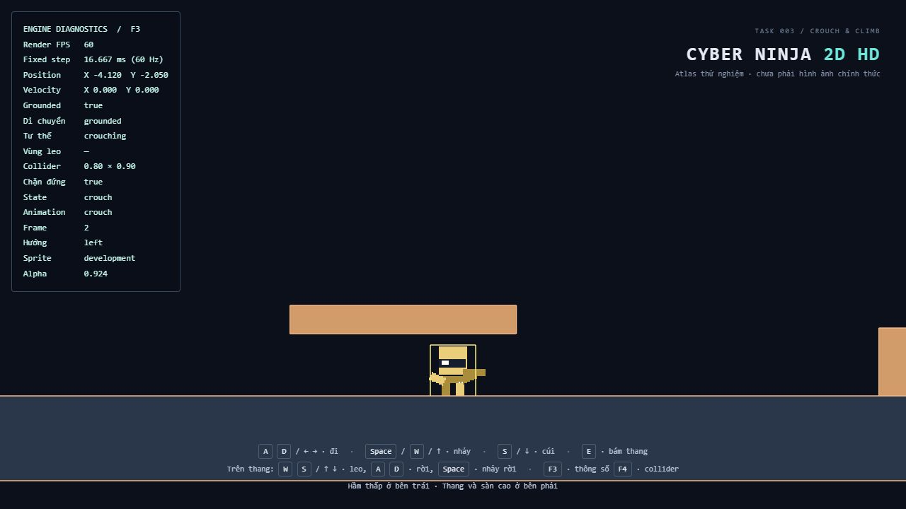
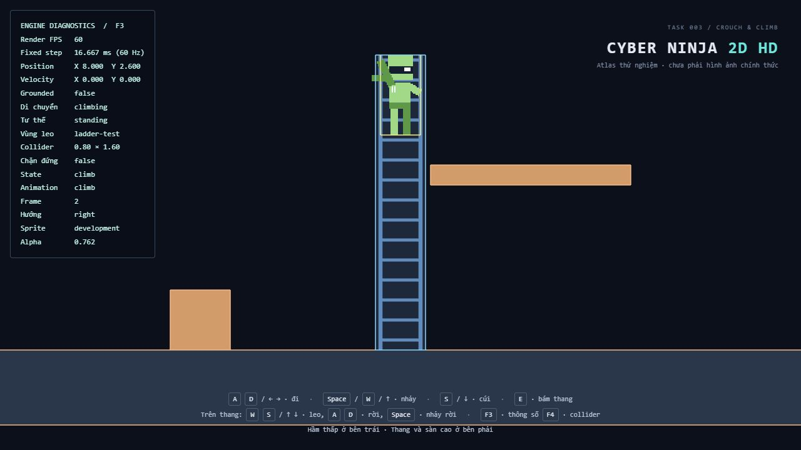

# Task 003 — Cúi người và leo thang

Mở rộng trực tiếp engine Task 002, giữ timestep 60 Hz, di chuyển/nhảy bình thường, va chạm tách trục, camera, nội suy, tải sprite và animation tiếp đất. Không thêm dependency.

## Tệp tạo mới

| Tệp | Trách nhiệm |
| --- | --- |
| `src/entities/PlayerMovementController.ts` | Logic di chuyển thuần: tư thế, kiểm tra đứng, bám/leo/rời thang và phân giải ngữ cảnh input; không phụ thuộc Three.js |
| `src/debug/CollisionDebug.ts` | F4: khung collider nhân vật màu vàng, khối rắn màu cam, vùng leo màu xanh; dùng chung geometry hình chữ nhật |
| `tests/Crouch.test.ts` | Khoảng trống, thay collider, giữ chân, tốc độ, chặn nhảy, đứng dưới trần, ra khỏi hầm và va chạm bên cạnh |
| `tests/Climb.test.ts` | Vùng leo, trọng lực, tốc độ, biên, nhảy/rời thang, căn ngang không xuyên tường, trần rắn và sàn cao |
| `tests/MovementInput.test.ts` | W/E/Space theo ngữ cảnh, alias, giữ phím, blur, không nhảy lặp |
| `tests/MovementAnimation.test.ts` | Pose mới, pause clip leo, fallback atlas cũ, nội suy đổi chiều cao và sân thử nghiệm thực tế |
| `tests/movement.fixtures.ts` | Body, thế giới và input thuần dùng chung cho kiểm thử |
| `docs/TASK-003.md`, `docs/task-003-crouch.png`, `docs/task-003-climb.png` | Báo cáo và ảnh thao tác thực tế |

## Tệp thay đổi

| Tệp | Nội dung |
| --- | --- |
| `src/physics/Collision.ts` | Kích thước body có thể đổi; thêm `ClimbableZone` với `id` và `kind` ladder/scaffolding |
| `src/physics/PhysicsWorld.ts` | `canOccupy`, `tryResize`, `findClimbable`, bước không trọng lực và phép quét ngang dùng để căn người vào thang |
| `src/config/game.config.ts` | Kích thước/tốc độ cúi, tốc độ leo, mái hầm, thang và sàn cao |
| `src/input/InputManager.ts` | Thêm Down, Up, E, cạnh Space riêng cho nhảy rời và F4; giữ nguyên jump Space/W/Up bên ngoài thang |
| `src/entities/Player.ts` | Kết nối controller, nội suy chiều cao, căn đáy sprite và placeholder khi đổi tư thế |
| `src/entities/PlayerAnimator.ts` | Crouch/Climb tùy chọn; đứng yên trên thang dừng frame; thiếu clip mới vẫn dùng được atlas cũ |
| `src/animation/AnimationController.ts` | Truy vấn `hasClip`; không đổi thuật toán tiến frame |
| `src/core/Game.ts` | Chuyển input cho movement controller, truyền mode/stance cho animator, reset vận tốc input khi pause và nối debug F4 |
| `src/debug/DebugOverlay.ts` | Mode, stance, vùng leo, kích thước collider và trạng thái chặn đứng |
| `src/world/TestLevel.ts` | Bốn khối rắn và một vùng thang riêng, với ray/bậc thang chỉ là visual |
| `src/rendering/Renderer.ts`, `index.html` | Nhãn trợ năng và hướng dẫn điều khiển mới |
| `scripts/generate_dev_atlas.py`, `public/assets/characters/ninja/ninja-atlas.png`, `public/assets/characters/ninja/animations.json` | Thêm hai frame cúi và bốn frame leo; atlas 384 × 560, tổng 23 frame/7 clip |
| `tests/SpriteSheetLoader.test.ts` | Cập nhật kích thước ảnh giả lập và phạm vi đếm 17 frame cũ khi atlas được mở rộng; giữ nguyên các trường hợp kiểm thử cũ |
| `README.md` | Liên kết tới báo cáo hiện tại |

Giữ đủ 66 trường hợp kiểm thử Task 001/002; thêm 37 trường hợp mới. Không sửa `GameLoop`, `GameCamera`, `SpriteRenderer`, bộ tải metadata, thông số chạy/nhảy/trọng lực cũ, package hoặc lockfile. Không chạy ESLint hay formatter.

## Kiến trúc di chuyển và va chạm

`PlayerMovementController` giữ stance (`standing`/`crouching`) và vùng leo đang bám. Mode được suy ra từ vùng đang bám và `body.isGrounded`: `climbing`, `grounded`, `airborne`. Facing do animator giữ độc lập. Animation chỉ đọc các trạng thái này, không quyết định có được đi, nhảy hay đổi collider hay không.

Mỗi bước: chụp vị trí/chiều cao trước đó → đọc input → kiểm tra stance/vùng leo → cập nhật vận tốc → `PhysicsWorld.step` đúng một lần → trạng thái logic → animator → tiêu thụ cạnh input. Hành vi normal vẫn dùng trọng lực -28, tốc độ chạy 6 và vận tốc nhảy 11.

`PhysicsWorld` nhận hai tập riêng: khối rắn AABB và vùng leo không rắn. `canOccupy(body, proposedPosition, proposedWidth, proposedHeight)` chỉ kiểm tra khối rắn, cho phép tiếp xúc cạnh và bỏ qua sai số mặt tiếp xúc dưới 1e-9 world unit. `tryResize` tính lại tâm từ vị trí chân cũ, kiểm tra occupancy rồi mới thay cả kích thước lẫn vị trí. Đề xuất bị chặn không sửa body.

Khi render, tâm và chiều cao đều được nội suy với cùng alpha. Sprite đặt tại `-renderHeight / 2` tương đối với tâm visual, vì vậy đổi chiều cao không kéo chân lên/xuống. Placeholder được scale cùng chiều cao. Collider chính thức vẫn dùng kích thước của bước mô phỏng hiện tại. Khung F4 của nhân vật dùng cùng pose nội suy để trùng visual; các khung môi trường là vị trí tĩnh thật. Debug không sửa physics.

## Bàn phím

| Ngữ cảnh | Phím | Hành động |
| --- | --- | --- |
| Bình thường | A/D hoặc ←/→ | Đi ngang |
| Bình thường | Space/W/↑ | Nhảy khi đang đứng trên nền |
| Trên nền | Giữ S/↓ | Cúi và đi chậm |
| Đang cúi | Nhả S/↓ | Thử đứng; nếu bị trần chặn thì tiếp tục cúi |
| Chồng lấp vùng leo | E mới bấm | Bám thang nếu tư thế đứng và đường căn ngang hợp lệ |
| Đang leo | W/↑, S/↓ | Leo lên/xuống; nhả cả hai thì đứng yên |
| Đang leo | Space mới bấm | Nhảy rời thang |
| Đang leo | A/D hoặc ←/→ | Rời sang bên nếu có thể dịch ngang an toàn |
| Mọi lúc | F3 | Bật/tắt thông số |
| Mọi lúc | F4 | Bật/tắt khung va chạm |

Up và Down cùng giữ thì vận tốc leo bằng 0. Space có action cạnh riêng cho thang, nên vẫn nhảy rời được khi W đang giữ. Cạnh W/Up được tiêu thụ trong bước leo và không bị xử lý lại thành jump khi chuyển mode. E và Space không lặp khi giữ phím. Blur xóa toàn bộ input; không có listener bàn phím mới trong Player hoặc animation.

## Quy tắc cúi

- Chỉ bắt đầu cúi khi grounded. Collider từ 0.8 × 1.6 thành 0.8 × 0.9; tâm hạ 0.35, chân không đổi.
- Tốc độ cúi 2.4 world unit/s; jump bị chặn khi stance vẫn crouching.
- Khi nhả S, đứng lên chỉ khi body đứng không chồng khối rắn. Nếu bị chặn, vẫn đi chậm và tiếp tục thử đứng khi có chỗ trống; không cần bấm lại S.
- Khi đi khỏi mép nền, thử trở lại stance đứng. Nếu khoảng trống không đủ thì giữ body ngắn để không xuyên hình; không tạo stance cúi mới trên không.
- Có thể nhả cúi rồi nhảy trong cùng một bước nếu tư thế đứng hợp lệ.

## Quy tắc leo

- E chỉ bám khi body chồng vùng leo; vùng phải đủ cao cho body đứng. Nếu đang cúi dưới trần và không thể đứng, từ chối bám.
- Giữ nguyên vị trí chân khi trở về body đứng, sau đó quét đường ngang tới tâm vùng bằng cùng phép giải va chạm. Nếu đường bị chặn, không căn xuyên tường và không dịch người một phần để vào thang.
- Khi climbing, `isGrounded` luôn false, trọng lực tắt, vận tốc ngang bằng 0. Leo theo tốc độ 2.8; thả input thì vận tốc Y bằng 0 và giữ bám.
- Giới hạn tâm tại `[zoneBottom + body.height/2, zoneTop - body.height/2]`: toàn bộ body nằm trong giới hạn dọc của vùng. Đỉnh/đáy dừng chuyển động, không tự kéo người lên sàn hoặc tự rời thang. Va chạm trần/sàn vẫn được quét trước khi đi tới vị trí mới.
- Muốn sang sàn cao, leo cho chân cao hơn mặt sàn rồi bấm hướng ngang. Đây là rời thang và tiếp đất bằng physics bình thường, không phải ledge pull-up.
- A/D chỉ rời nếu phép quét ngang có khoảng dịch chuyển hợp lệ. Nếu sát tường chặn hoàn toàn thì tiếp tục bám. Rời ngang đặt vận tốc Y về 0 rồi bước normal bật lại trọng lực.
- Space rời thang bằng vận tốc nhảy cũ, sau đó trọng lực normal hoạt động. Không yêu cầu grounded vì đây là jump từ vùng đang bám; body phải đang có vị trí hợp lệ.
- Nếu vị trí bị đặt ra ngoài vùng đang bám, bước kế tiếp bỏ vùng đó và bật lại gravity. `resetInput` dừng vận tốc ngang và vận tốc leo, không xóa vận tốc nhảy/rơi normal. Pause hoặc mất focus không tự thả người khỏi thang.

Các quy tắc này hỗ trợ ladder/scaffolding bằng dữ liệu vùng, không dò tọa độ đặc biệt của sân thử nghiệm. Không có wall climb, wall jump, ledge grab hoặc tự kéo qua mặt sàn.

## Animation và asset

Grounded + crouching chọn Crouch. Climbing chọn Climb; velocity Y bằng 0 thì tốc độ phát bằng 0, giữ frame hiện tại. Rời thang vào không khí chọn Jump/Fall theo velocity; rời lên nền chọn Land rồi Idle/Run như trước. Đứng sau cúi chọn Idle/Run. Facing không bị reset khi bám hoặc đứng yên.

Hai clip mới là tùy chọn. Nếu atlas cũ chỉ có năm clip bắt buộc, Crouch dùng Idle và co visual đứng theo chiều cao collider; Climb dùng pose Fall. Đổi atlas ngay khi đang phát Crouch/Climb cũng chọn clip dự phòng hợp lệ. Không làm hỏng quá trình tải sprite chỉ vì thiếu hai clip này. PNG mới vẫn là hình học thử nghiệm, không phải artwork ninja production. Schema JSON version 1, các clip cũ, trim/pivot và anchor chân được giữ nguyên.

## Sân thử nghiệm

- Nền rộng và vật cản cũ giữ nguyên.
- Mái hầm bên trái: mặt dưới -1.4, nền -2.5, khoảng trống 1.1 — đủ cho body cúi 0.9, chặn body đứng 1.6.
- Thang bên phải tại X=8, đáy -2.5, đỉnh 3.4. Ray/bậc thang là visual; chỉ vùng màu xanh được dùng để kích hoạt leo.
- Sàn cao bên cạnh có mặt trên Y=1.2; leo gần đỉnh rồi rời sang phải để đứng lên sàn.
- F4 dùng màu vàng cho body, cam cho khối rắn và xanh cho vùng leo. Tất cả vẫn chỉ là playground phát triển.

## Kết quả kiểm chứng thực tế

`npm run test`: **103/103 đạt, 15/15 tệp đạt** (66 cũ + 37 mới). Physics và movement controller chạy không cần WebGL. Bao gồm 600 lần đổi tư thế, 30 vòng bám/rời, hai hướng leo, kiểm tra biên, quét tường mỏng, trần chặn, không nhảy lặp, clip cũ, đổi atlas trong pose mới, fallback và nội suy.

Lượt đầu có 101/102 đạt: kiểm thử sân thử nghiệm yêu cầu đứng khi tâm đã ra khỏi hầm nhưng nửa collider vẫn còn dưới mái. Đã sửa kiểm thử chờ mép collider ra khỏi mái, không nới quy tắc đứng; lượt chạy lại đạt toàn bộ.

`npm run build`: **đạt** (TypeScript strict + Vite). JavaScript minify 554.07 kB, gzip 140.03 kB. Vite vẫn cảnh báo chunk trên 500 kB; không làm build thất bại.

Vite phục vụ Task 003 tại `http://127.0.0.1:5174/`; HTTP trả 200. Đã thao tác bàn phím thật trong trình duyệt và quan sát:

| Trường hợp | Kết quả thủ công |
| --- | --- |
| Giữ S+A đi vào hầm, nhả S bên dưới mái | Giữ crouching, collider 0.8 × 0.9, `standingBlocked=true` |
| Bấm Space và giữ S dưới mái | Không nhảy, không đứng xuyên mái, chân giữ trên nền |
| Đi ra khỏi hầm không giữ S | Tự đứng, collider 0.8 × 1.6, chặn đứng false |
| Cúi/đứng nhanh rồi nhảy | Nhảy bình thường ở stance đứng |
| Nhảy qua vật cản cũ | Thành công; Land vẫn phát sau khi chạm nền |
| Giữ W khi bấm E trong vùng | Căn X vào thang, mode climbing, không nhảy nhầm |
| Leo lên/xuống và nhả phím | Di chuyển dọc; dừng Y khi nhả, frame Climb giữ yên |
| Đỉnh thang | Dừng tại tâm Y=2.6, đầu không vượt đỉnh Y=3.4 |
| Rời bằng D từ đỉnh sang sàn cao | Grounded tại tâm Y=2.0, chân Y=1.2, vùng leo được xóa |
| Bám lại gần sàn cao | Trở về mode climbing, không xuyên mặt sàn |
| F3/F4, camera và sprite | Thông số mới và khung hiển thị đúng; camera đi theo X trong các thao tác trên |

**Chưa xác nhận thủ công đầy đủ:** biên đáy thang, Space nhảy rời khi W vẫn giữ, toàn bộ chu kỳ bám/rời lặp nhiều lần, trường hợp căn thang bị tường/trần chặn, và blur/pause/resume khi đang giữ input leo. Những trường hợp này có kiểm thử tự động. Đã thử chuyển tab nhưng IAB vẫn báo `document.hidden=false`, nên không coi đó là kiểm chứng pause/resume thực tế của browser.

## Giới hạn và bước tiếp theo

Chưa có sprite production, checkpoint/respawn hay map chính thức. Vùng leo là hình chữ nhật tĩnh; không hỗ trợ thang chuyển động, ledge pull-up hoặc tự bước lên mặt sàn. Không phát hiện điểm bám dựa trên pixel artwork. Tài nguyên production cần bổ sung clip Crouch/Climb với pivot chân phù hợp; các clip khác vẫn dùng hợp đồng Task 002.

Đề xuất Task 004: bổ sung điểm spawn/checkpoint và hồi sinh, kèm dữ liệu màn chơi cho solid/climbable để đưa hai cơ chế này vào bản đồ sau đó.

## Ảnh kiểm tra

