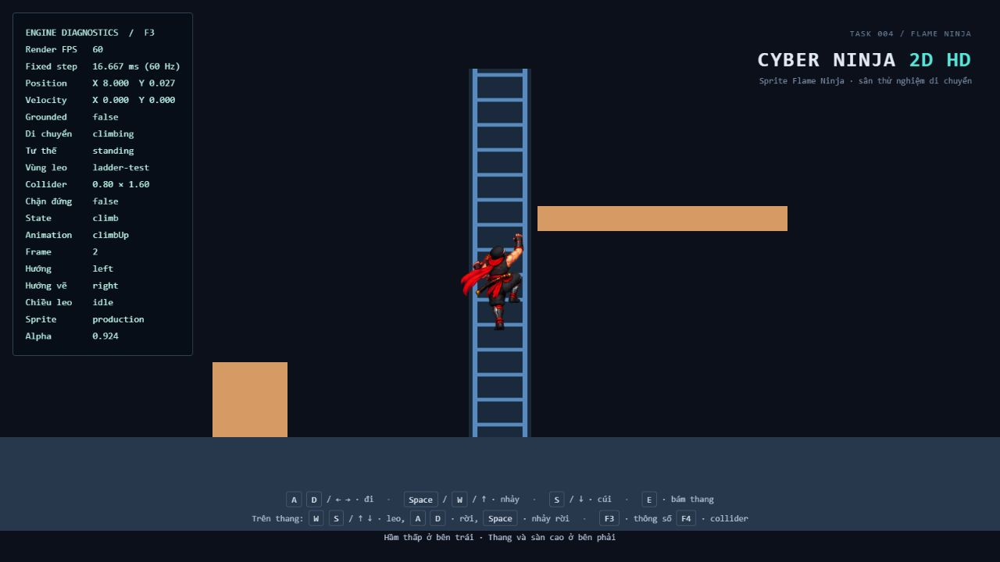
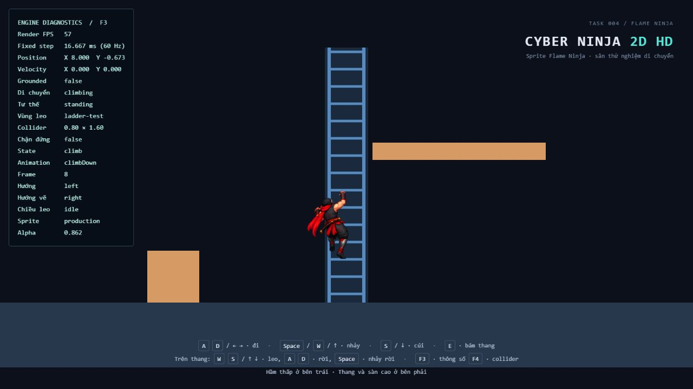
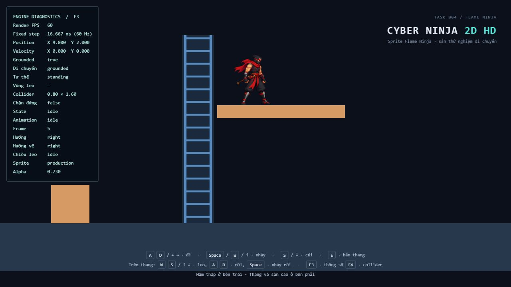
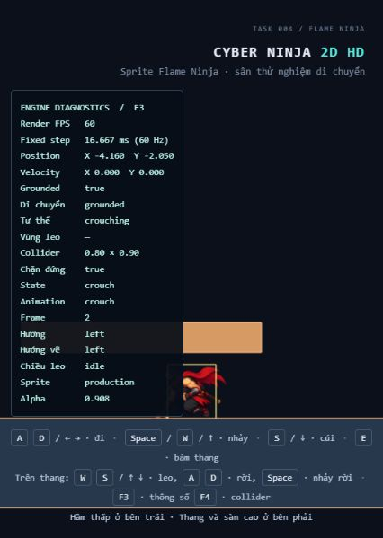

# Task 004 — Tích hợp sprite Flame Ninja

Đã tích hợp vào dự án Task 003 hiện có, dùng thư mục asset đã giải nén do người dùng cung cấp tại `sprite_v2/Cyber_Ninja_Task004_Compatible_v4/public/assets/characters/ninja/`. Không thay engine, physics, input, camera, timestep 60 Hz hoặc cấu trúc màn chơi.

## Tệp đã thay đổi và tạo mới

| Tệp | Thay đổi |
| --- | --- |
| `public/assets/characters/ninja/animations.json` | Chép nguyên metadata production từ gói v4; vẫn là URL runtime cũ |
| `public/assets/characters/ninja/flame-ninja-atlas.png` | Chép nguyên PNG RGBA 3136 × 1968, gồm các frame nguồn 384 × 320 |
| `public/assets/characters/ninja/development-animations.json` | Lưu metadata phát triển Task 003 trước khi thay thế; ảnh `ninja-atlas.png` cũ vẫn giữ nguyên |
| `src/entities/PlayerAnimator.ts` | Chọn ClimbUp/ClimbDown theo vận tốc thực, giữ pose đứng yên, fallback clip cũ, tách hướng vẽ leo khỏi facing bên hông |
| `src/entities/Player.ts` | Truyền `renderFacing` cho renderer ở lúc tải và đồng bộ frame; không đổi collider hoặc logic di chuyển |
| `src/animation/AnimationController.ts` | Getter `duration` để hiệu chỉnh playback theo quãng đường |
| `src/config/game.config.ts` | Thêm quãng đường 0.8 unit/chu kỳ leo và epsilon vận tốc 1e-6; giữ nguyên các tham số physics |
| `src/debug/DebugOverlay.ts` | Thêm hướng vẽ và chiều leo thực tế |
| `index.html` | Nhãn Task 004 và Flame Ninja |
| `scripts/generate_dev_atlas.py` | Chỉ ghi metadata phát triển, tránh ghi đè `animations.json` production khi chạy lại công cụ cũ |
| `tests/MovementAnimation.test.ts`, `tests/SpriteSheetLoader.test.ts` | Các trường hợp kiểm thử phát triển cũ đọc metadata lưu riêng; giữ nguyên các trường hợp và kết quả mong đợi |
| `tests/ProductionSprites.test.ts` | 17 kiểm thử mới đọc metadata runtime thật, PNG header, hai chiều leo, giữ frame, hướng vẽ, tỷ lệ, pivot, collider và fallback |
| `README.md`, `docs/TASK-004.md` | Liên kết và báo cáo hiện tại |
| `docs/task-004-crouch.png`, `docs/task-004-climb-up.png`, `docs/task-004-climb-down.png`, `docs/task-004-idle.png` | Ảnh từ game thực tế |

Không sửa `SpriteSheetLoader`, `SpriteRenderer`, `PlayerMovementController`, `PhysicsWorld`, `InputManager`, `GameLoop`, `Game`, `GameCamera` hoặc `TestLevel`. Không thêm dependency và không đổi package/lockfile. Không chạy lint hay formatter.

## Asset runtime và phạm vi

Runtime tiếp tục đọc `assets/characters/ninja/animations.json`, sau đó giải `flame-ninja-atlas.png` tương đối với URL JSON. Hai tệp runtime được đối chiếu byte với nguồn và giống hoàn toàn.

| Clip | Frame | Trạng thái sử dụng |
| --- | ---: | --- |
| idle | 6 | Đứng trên nền |
| run | 8 | Di chuyển ngang trên nền |
| jump | 4 | Bay lên |
| fall | 3 | Rơi xuống |
| land | 3 | Tiếp đất, phát một lần như Task 002 |
| crouch | 2 | Hai pose thấp, phù hợp hầm Task 003 |
| climbUp | 8 | Leo lên theo vận tốc Y thực tế |
| climbDown | 8 | Leo xuống bằng bộ pose riêng |
| climb | 8 | Dữ liệu tương thích cho atlas/animator cũ |
| climbIdle | 1 | Giữ dưới dạng dữ liệu, không tự chuyển vào khi dừng |
| crouchEnter | 4 | Giữ dưới dạng dữ liệu, không kích hoạt |
| hurt | 4 | Giữ dưới dạng dữ liệu, không kích hoạt |

Các strip leo riêng không cần tải thêm vì đã nằm trong atlas chính. Không dùng ảnh JPG trong `references/` hoặc dữ liệu trong `legacy-originals/` làm runtime. Ladder/ray/bậc vẫn chỉ do `TestLevel` vẽ; sprite nhân vật không chứa thang. Asset Attack 1/2/3 được giữ nguyên tại gói nguồn cho task combat sau, không chép vào luồng animation đang chạy, không thêm state/input/hitbox chiến đấu.

## Tỷ lệ và công thức pivot

Metadata nguồn: `visual.width=2.4`, `visual.height=2`, scale `(1,1)`, source 384 × 320. Vì vậy:

```text
unitX = 2.4 / 384 = 0.00625 world unit / pixel
unitY = 2.0 / 320 = 0.00625 world unit / pixel
pivot = (192, 289), tính từ góc trên trái canvas nguồn
meshCenterX = (offsetX + frameWidth/2 - pivotX) × unitX
meshCenterY = (pivotY - offsetY - frameHeight/2) × unitY
```

Với frame đầy đủ của gói này, tâm mesh là `(0, 0.80625)` tương đối với chân; kích thước mesh luôn `2.4 × 2.0`. Root sprite nằm tại `-renderHeight/2` tương đối tâm body nội suy. Do đó điểm pivot chân trùng đáy body ở mọi alpha, và không thay đổi khi đổi clip. Không suy collider từ pixel ảnh hoặc tự resize visual theo chiều cao vùng alpha.

Collider vẫn **0.8 × 1.6 khi đứng**, **0.8 × 0.9 khi cúi**. Crouch có pose thật nên scale nhóm visual luôn `(1,1,1)`, không ép toàn bộ canvas về chiều cao 0.9. Các pose co chân khi Jump hoặc hạ người khi Land thay đổi vùng pixel nhìn thấy theo artwork, trong khi tỷ lệ world/pixel giữ nguyên.

## Chọn clip, hướng vẽ và tốc độ leo

- Mode climbing là nguồn trạng thái; animation chỉ đọc velocity của body sau physics.
- Velocity Y > 1e-6 chọn `climbUp`; < -1e-6 chọn `climbDown`. Khi không có vận tốc thực, giữ nguyên clip/frame leo hiện tại với playback speed bằng 0, không chuyển lại `climbIdle` và không reset pose.
- Nếu vừa vào thang đứng yên mà chưa có pose leo, chọn frame đầu của clip leo khả dụng. Khi bắt đầu đi xuống, chọn clip Down thật; không reverse hoặc mirror Up để thay Down.
- Nếu clip theo hướng thiếu, dùng generic `climb`; nếu cả generic cũng thiếu, dùng fallback Fall như trước. Đổi atlas cũ ngay trong lúc đang leo theo hướng cũng có fallback hợp lệ.
- `facing` trái/phải vẫn được lưu độc lập. `renderFacing` luôn phải khi climbing để ảnh nhìn từ sau không bị mirror theo facing cũ. Khi rời thang, khôi phục việc lật ảnh bên hông theo facing hiện tại.
- Chu kỳ animation riêng được hiệu chỉnh tương ứng 0.8 world unit, tức hai bậc thang playground, mỗi bậc 0.4. Công thức tốc độ:

```text
clipDuration = frameCount / clipFPS / clip.speed
playbackSpeed = abs(actualVelocityY) × clipDuration / 0.8
```

Với 8 frame, tốc độ leo 2.8 unit/s cho 3.5 chu kỳ/s, tức 28 frame/s. Bước cuối gần biên chỉ tiến animation theo quãng đường thực đã đi; khi bị chặn, velocity bằng 0 nên frame dừng dù vẫn giữ W/S. Generic clip cũ tiếp tục dùng tốc độ theo tỷ lệ velocity với tốc độ leo cấu hình để giữ hành vi Task 003.

Nếu màn chơi sau dùng khoảng cách bậc khác, có thể chỉnh riêng `climbAnimationDistancePerCycle`, không sửa physics hoặc metadata nguồn.

## Kiểm chứng ảnh gốc

Đã đọc PNG runtime bằng Pillow và kiểm tra cả 12 clip, gồm **59 lượt tham chiếu / 48 vùng frame riêng biệt**:

- Tất cả frame có alpha khác 0; không còn frame trống.
- Không frame nào vượt biên PNG hoặc có nội dung chạm/cắt sát biên canvas frame.
- Padding 4 px quanh mọi vùng frame đều trong suốt; không có nội dung từ frame kế cận tràn vào padding. Runtime vẫn dùng linear filter và tắt mipmap như metadata/loader hiện tại.
- Hai frame Crouch có vùng alpha cao 0.875 và 0.8875 world unit, đều dưới collider crouch 0.9.
- `crouchEnter` có pose cao tới 1.1375 unit, vì vậy không kích hoạt clip chuyển tiếp này trong hầm.
- PNG và JSON runtime giống nguồn theo byte; PNG SHA256:
  `3b3464d1abbc54fc22933755d2ce8c0b62f40434e4954545012487ea678ca213`.

Runtime validation không bị nới lỏng. Các kiểm thử mới còn dùng chính đường dẫn từ `gameConfig.player.spriteMetadata`, xác nhận đủ tám clip bắt buộc và tất cả vùng, gồm clip tùy chọn, nằm trong ảnh PNG thực.

## Test và build thực tế

- `npm run test`: **120/120 đạt, 16/16 tệp đạt**. Giữ đủ 103 trường hợp cũ; thêm 17 trường hợp production. Không cần WebGL cho unit test.
- Lượt đầu đạt 119/120; phép so sánh tỷ lệ X dùng equality tuyệt đối gặp `0.0062499999999999995` thay vì `0.00625`. Đã sửa kiểm thử dùng dung sai số thực tới 12 chữ số, không đổi công thức render hoặc dữ liệu asset. Lượt chạy lại đạt toàn bộ.
- `npm run build`: **đạt**, gồm TypeScript strict và Vite. JavaScript minify 554.96 kB, gzip 140.32 kB. Còn cảnh báo chunk trên 500 kB; không chặn build.
- Dev server khởi động thành công tại `http://127.0.0.1:5174/`, dùng Node 24.22.1 có sẵn.

## Thao tác trong trình duyệt đã kiểm tra

Đã kiểm tra bằng bàn phím trong game, không gọi trực tiếp vào physics để dàn cảnh. IAB ban đầu bị giới hạn khoảng 1 FPS; tab kiểm tra riêng sau đó chạy khoảng 56–60 FPS, trong khi fixed step luôn 16.667 ms.

| Chuỗi / trạng thái | Kết quả quan sát |
| --- | --- |
| F3/F4, đứng sau khi rơi xuống nền | Sprite production hiển thị; Idle có đủ các frame đã kiểm tra, collider đứng 0.8 × 1.6 |
| Giữ S+A vào hầm, nhả S dưới mái | Crouch thật, collider 0.8 × 0.9, standingBlocked true, không dùng pose CrouchEnter cao |
| D rời hầm | Đứng lại khi đủ headroom; không đổi tỷ lệ pixel của nhân vật |
| D+Space qua vật cản, Space nhảy tại chỗ | Đã quan sát Jump, Fall, Land rồi Idle; không thấy frame trắng/trống trong các thao tác |
| D tới X≈7.7, A đổi hướng trái, W+E bám và leo | `Animation climbUp`, `facing left`, `renderFacing right`, sprite nhìn từ sau không bị lật |
| S leo xuống rồi nhả | `Animation climbDown`, frame 8; sau nhiều lần đọc vẫn giữ frame 8 và cùng vị trí Y=-0.673 |
| W tới đỉnh, tiếp tục giữ W | Tâm Y=2.6, velocity Y=0, ClimbUp frame 1 giữ nguyên; không tiếp tục chạy chân khi bị chặn |
| D rời thang sang sàn cao | Grounded tại tâm Y=2.0, Idle bên hông, facing/renderFacing phải; thang vẫn là vật thể thế giới |

Đã kiểm tra Run thông qua di chuyển A/D và render toàn bộ frame bằng unit test; không lưu được ảnh riêng cho từng frame Run đang chạy. Không quay video. Chưa đo trên nhiều màn hình vật lý hoặc mọi tỷ lệ DPR; không khẳng định FPS luôn 60 trong môi trường IAB. Không phát hiện cảnh báo/lỗi trong console của tab kiểm tra riêng tại thời điểm kiểm tra cuối.

## Giới hạn artwork và phạm vi còn lại

Giữ nguyên atlas và pivot đúng gói nguồn. Vùng alpha của một vài pose có viền chân vượt pivot 1–3 px (khoảng 0.00625–0.01875 world unit); một số pose Run có chân nâng lên và pose leo có độ nghiêng ngang khác nhau theo ảnh gốc. Điểm neo và tỷ lệ render không nhảy; không tự co giãn hay dịch từng frame để che khác biệt artwork. Nếu cần tiếp xúc pixel tuyệt đối hoặc cycle leo ít nghiêng hơn, cần chỉnh artwork/metadata ở một task asset riêng.

Chưa có combat, Hurt gameplay, crouch-enter transition hoặc map production. Những dữ liệu tùy chọn vẫn được giữ nhưng không được tự kích hoạt. Physics, đứng dưới trần, nhảy rời thang và toàn bộ cơ chế Task 003 vẫn do controller cũ quyết định.

## Ảnh game thực tế








