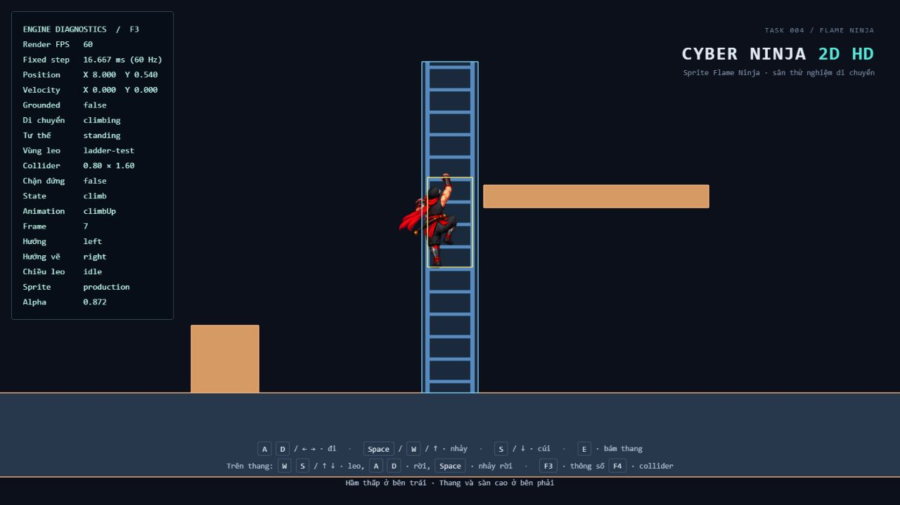
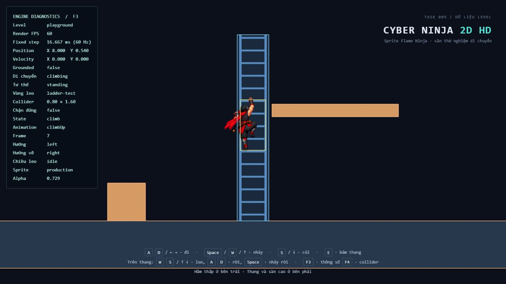
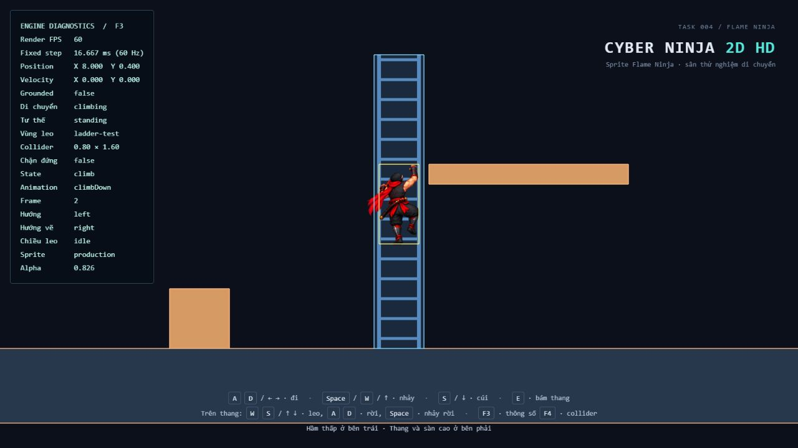
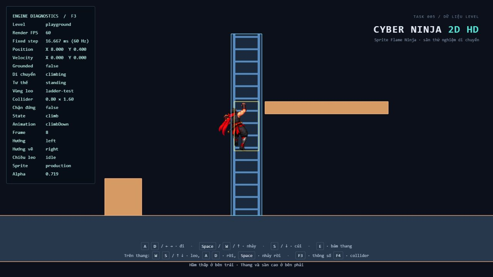
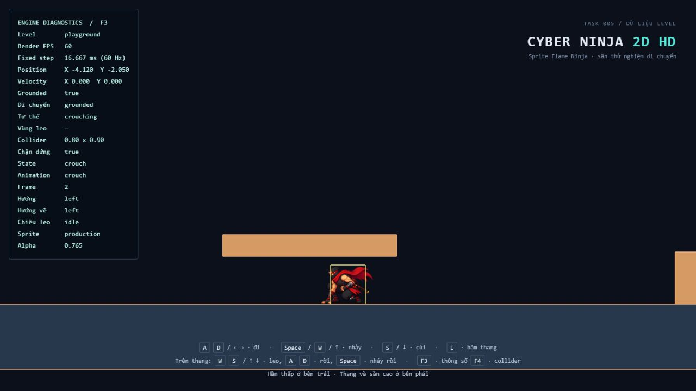
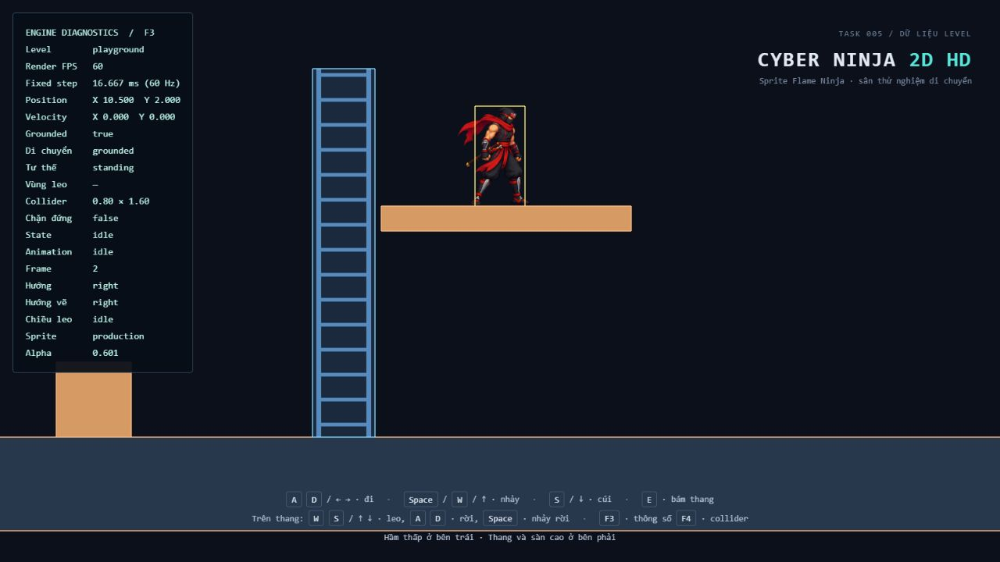
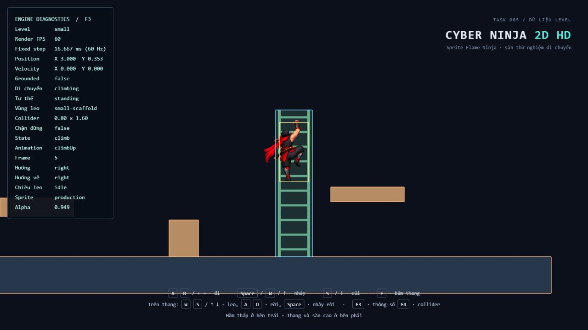

# Task 005 — Tilemap & Level Foundation

## Phạm vi và hiện trạng đã đọc

Đã đọc `docs/TASK-003.md`, `docs/TASK-004.md`, `TestLevel`, `game.config.ts`, `Game`, `Player`, movement controller, physics/collision, animation, debug/input và các test liên quan trước khi sửa. Không tìm thấy `AGENTS.md` trên đĩa trong project hoặc các thư mục cha đã tra cứu; áp dụng đầy đủ hướng dẫn AGENTS.md người dùng cung cấp trong cuộc trò chuyện. Không chạy lint hoặc formatter.

Task này tạo nền tảng level bằng các hình chữ nhật trong JSON, dựng lại playground cũ và thêm một level thử. Chưa xây tile grid, Map 1, editor, streaming hoặc hệ thống map production. Không thêm dependency.

## File thay đổi

| File | Thay đổi |
| --- | --- |
| `src/world/LevelData.ts` | Kiểu dữ liệu, đọc/chuẩn hóa dữ liệu unknown và báo lỗi có đường dẫn trường |
| `src/world/levels/playground.json` | Spawn, bốn solid, vùng leo và visual tương ứng playground Task 004 |
| `src/world/levels/small.json` | Level thử thứ hai: spawn, hình học và vùng scaffolding riêng |
| `src/world/levels/index.ts` | Registry tĩnh, chọn level theo tên và báo lỗi tên không tồn tại |
| `src/world/TestLevel.ts` | Dựng collider, climbable và mesh từ dữ liệu; giữ constructor mặc định tương thích |
| `src/config/game.config.ts` | Spawn mặc định tham chiếu playground JSON; bỏ hình học level khỏi config engine |
| `src/entities/Player.ts` | Nhận spawn qua constructor, dùng `setPosition` hiện có để đồng bộ lịch sử interpolation |
| `src/core/Game.ts` | Truyền dữ liệu vào level/player, kiểm tra khoảng trống spawn trước renderer, giải phóng level khi khởi tạo renderer thất bại |
| `src/debug/DebugOverlay.ts` | Hiển thị tên level trong F3 |
| `src/main.ts` | Chọn level qua query string, hiển thị nguyên nhân lỗi khởi động |
| `src/animation/AnimationController.ts` | Tùy chọn giữ pha khi chuyển hai clip lặp; mặc định vẫn reset |
| `src/entities/PlayerAnimator.ts` | Chỉ bật giữ pha cho chuyển đổi Climb Up/Down |
| `tsconfig.json` | Bật import JSON bằng `resolveJsonModule` |
| `tests/LevelData.test.ts` | 41 trường hợp về dữ liệu, lỗi, tương ứng playground và level thứ hai |
| `tests/ClimbTransition.test.ts` | 6 trường hợp giữ pha, đổi chiều, dừng, reset và one-shot |
| `index.html`, `README.md` | Nhãn Task 005 và đường dẫn hướng dẫn hiện tại |
| `docs/TASK-005.md`, `docs/task-005-*.png` | Báo cáo và ảnh thao tác trước/sau |

Không sửa timestep, input, camera, interpolation loop, movement controller, physics/collision, collider nhân vật, atlas, scale hoặc pivot sprite. Không thêm combat, AI, checkpoint hay respawn. Thư mục hiện không phải Git repository nên không có Git diff/commit; đã đọc lại các phần sửa để rà phạm vi.

## Cấu trúc dữ liệu

Ví dụ tối thiểu có sàn và vùng leo:

```json
{
  "version": 1,
  "id": "example",
  "spawn": { "x": 0, "y": 1.8 },
  "solids": [
    { "id": "floor", "position": { "x": 0, "y": -3 }, "width": 20, "height": 1 }
  ],
  "climbables": [
    { "id": "ladder", "kind": "ladder", "position": { "x": 3, "y": -0.5 }, "width": 1, "height": 4 }
  ],
  "visuals": [
    { "shapeId": "floor", "kind": "rectangle", "color": "#27374c" },
    { "shapeId": "ladder", "kind": "ladder", "color": "#578bbf", "opacity": 0.2, "rungSpacing": 0.4 }
  ]
}
```

Tọa độ là tâm hình chữ nhật trong world, X sang phải, Y lên trên. `solids` đi vào PhysicsWorld; `climbables` là vùng leo loại `ladder` hoặc `scaffolding`, không tự thành solid. `visuals` chỉ định cách vẽ qua `shapeId`: rectangle hoặc ladder với hai ray/bậc trang trí. Ray và bậc không sinh collider. Visual có thể bị bỏ khỏi mảng mà collision vẫn giữ nguyên; màu/opacity không ảnh hưởng physics. Hiện visual dùng kích thước hình được tham chiếu, chưa có lớp trang trí với transform độc lập hoặc tile atlas. Collider nhân vật vẫn lấy từ cấu hình engine, không lấy từ pixel sprite.

`parseLevelData(unknown)` yêu cầu đủ `version`, `id`, `spawn`, `solids`, `climbables`, `visuals`. Mảng được phép rỗng; không tự đặt quy tắc màn chơi phải có sàn. Parser sao chép dữ liệu cần dùng và kiểm tra:

- Version bằng 1; ID không rỗng; ID hình không trùng giữa solid và climbable.
- Tọa độ là số hữu hạn; chiều rộng/cao hữu hạn và lớn hơn 0; biên hình không tràn số.
- Loại vùng leo/visual hợp lệ; tham chiếu visual phải tồn tại; visual ladder phải trỏ vùng leo.
- Màu là `#RRGGBB` hoặc số nguyên 0..16777215; opacity thuộc 0..1, mặc định 1.
- `rungSpacing` hữu hạn và dương, mặc định 0.4; giới hạn kỹ thuật 4096 bậc mỗi visual ladder để tránh dựng mesh không giới hạn.

Lỗi chỉ rõ trường, ví dụ `Dữ liệu level không hợp lệ: solids[0].width phải lớn hơn 0`. Registry báo tên level không tồn tại cùng danh sách có thể chọn. Game còn kiểm tra collider đứng tại spawn bằng `PhysicsWorld.canOccupy`; spawn chồng solid bị báo lỗi trước khi tạo WebGL. Không yêu cầu spawn đã đứng trên sàn, vì hành vi cũ là rơi xuống từ trên cao.

Luồng: query string → registry JSON → TestLevel/parser → solids/climbables vào PhysicsWorld, spawn vào Player, visuals vào Three.js. `new TestLevel()` và `new Game(container)` vẫn dùng playground. `new Game(container, data)` nhận dữ liệu riêng. `gameConfig.player.spawn` giữ alias spawn playground để các caller Player mặc định cũ tiếp tục hoạt động.

## Playground được bảo toàn

| Hình | Tâm X/Y | Rộng × cao |
| --- | --- | --- |
| Ground | 0 / -3.25 | 160 × 1.5 |
| Obstacle | 4 / -1.9 | 1.2 × 1.2 |
| Mái hầm | -5 / -1.15 | 4 × 0.5 |
| Sàn cao | 10.6 / 1 | 4 × 0.4 |
| `ladder-test` | 8 / 0.45 | 1 × 5.9 |

Spawn vẫn (0, 1.8), mặt đất Y=-2.5, khoảng trống hầm 1.1, mặt sàn cao Y=1.2. Thứ tự solid giữ nguyên. Visual vẫn màu cũ, 22 mesh gồm bốn solid, nền vùng leo, hai ray và 15 bậc; ray rộng 0.08, offset ngang ±0.4 lần chiều rộng vùng, bậc cách 0.4 và dày 0.06. Vòng dựng bậc dùng chỉ số nguyên thay cho cộng dồn số thực; vị trí tương ứng được so với mốc cũ với sai số số thực.

## Thêm level

1. Tạo JSON trong `src/world/levels/`, theo schema trên; chọn spawn có khoảng trống cho collider đứng 0.8 × 1.6.
2. Import JSON và thêm một entry vào `levels` trong `src/world/levels/index.ts`.
3. Mở `/?level=<tên entry>`. Không cần sửa physics, movement hoặc renderer.

Hiện có `playground` (mặc định) và `small`. Trên máy kiểm thử: `http://127.0.0.1:5174/` và `http://127.0.0.1:5174/?level=small`. Đây là registry compile-time, chưa có tải file tùy ý hoặc đổi level trong lúc chơi. Dữ liệu sai dừng khởi tạo và hiển thị nguyên nhân; không tự sửa dữ liệu hoặc fallback âm thầm.

## Đánh giá Climb Up/Down trước và sau sửa

Đã chạy bản Task 004 trước khi sửa, bật F3/F4 và điều khiển bằng bàn phím trong trình duyệt. Đã leo hai chiều, nhả phím giữa thang, giữ ở hai đầu và đổi hướng tại nhiều pha. Facing logic trái nhưng hướng vẽ leo vẫn phải, sprite không bị lật; tâm X=8 và thang đứng yên trong world. Frame được giữ khi không di chuyển.

Trước sửa, một chuỗi quan sát được: Up frame 7 tại Y=0.540 → S 40 ms → Down frame 2 tại Y=0.400. Những lần W/S khác cũng quay về đầu clip, tạo cú đổi tư thế/nghiêng ngang dễ thấy dù collider X không đổi. Nguyên nhân có thể xác định trực tiếp trong code: `play()` reset elapsed/index khi tên clip thay đổi.

Sửa nhỏ: thêm tùy chọn `preservePhase` cho hai clip loop, ánh xạ phần trăm chu kỳ đang phát sang clip mới. PlayerAnimator chỉ dùng tùy chọn này giữa `climbUp` và `climbDown`. Restart tường minh, one-shot, vào/ra leo và các animation khác giữ hành vi cũ. Tốc độ vẫn dựa trên quãng đường/vận tốc thực của Task 004; không can thiệp physics hoặc chỉnh atlas/pivot để che hình.

Sau sửa, thao tác tương tự cho kết quả Up frame 7 → Down frame 8, không bị kéo về frame 2. Các chuỗi khác quan sát được Down 8 → Up 3 → Down 1 → Up 3; số frame đi qua cuối chu kỳ rồi wrap tự nhiên. Dừng giữa thang giữ Up frame 3 tại Y=0.307 qua hai lần quan sát cách nhau; giữ W ở đỉnh Y=2.600 giữ Up frame 2; giữ S ở đáy Y=-1.700 giữ Down frame 4. Không thấy sprite bị lật, thang chạy theo nhân vật hoặc frame trống/chớp trong những lần quan sát này.

Giới hạn hình ảnh còn lại: thay đổi nghiêng ngang giữa các pose vẫn thấy trong atlas, bàn tay/bàn chân không khóa chính xác vào từng bậc và còn trượt tương đối khi di chuyển. Giữ pha loại bỏ cú reset chu kỳ nhưng không làm hai bộ pose riêng trở thành chuyển động liên tục tuyệt đối; bước nhảy hình giữa hai frame rời rạc vẫn có thể thấy. Chưa đo độ lệch pixel/foot contact bằng công cụ hoặc duyệt mọi cặp frame. Nếu cần khóa tay/chân theo bậc hoặc chuyển pose mượt ở mọi pha, cần quyết định nghệ thuật/chỉnh asset tương ứng; task này giữ nguyên asset.

Ảnh đối chiếu (frame F3 hiển thị theo chỉ số bắt đầu từ 1):

| Trước | Sau |
| --- | --- |
|  |  |
|  |  |

## Kết quả test và build

Chạy bằng Node 24.22.1 bundled vì Node mặc định trên máy là 16.15.0. Không đổi package hoặc lockfile.

- `npm run test`: exit 0; **167 test qua, 18 file qua** (120 test hiện có + 47 test mới), thời gian 3.33 s. Vitest có gợi ý hiệu năng không chặn: 18 worker, có thể tiết kiệm khoảng 354 ms bằng `isolate: false`; giữ nguyên cấu hình vì ngoài phạm vi.
- `npm run build`: exit 0; `tsc --noEmit && vite build` thành công, 28 module, Vite build 883 ms. Output: HTML 1.28 kB (gzip 0.70), CSS 1.52 kB (gzip 0.70), JS 559.48 kB (gzip 141.87). Lần chạy này không in cảnh báo build; không suy từ cảnh báo của các task trước.
- Không chạy ESLint, Prettier hoặc lệnh formatter. TypeScript check chỉ chạy như một phần script build được task này cho phép.

Test mới kiểm tra dữ liệu bắt buộc/không hợp lệ, ID kế thừa và ID trùng, màu/default, tham chiếu, rung limit, spawn bị chặn, hình học/climbable/spawn/headroom playground so với literal Task 004 độc lập, mesh/màu/bậc, trace input cùng kết quả physics/stance/interpolation trước và sau chuyển dữ liệu, cùng level small dùng nguyên PhysicsWorld để leo sang sàn khác. Animation test bao gồm loop khác độ dài/FPS, reset/restart, one-shot, giữ frame ở các pha 1/3/6 và đảo chiều 240 bước liên tục. Test thuần không cần WebGL; nghiệm thu renderer thực hiện riêng trong trình duyệt.

## Thao tác thực tế sau sửa

Thực hiện qua bàn phím ở bản dev trên trình duyệt in-app, quan sát ảnh và F3/F4 (thường 60 FPS sau khởi động). Không dùng teleport/debug mutation để thay cho thao tác.

| Trường hợp | Kết quả quan sát |
| --- | --- |
| Playground: S+A vào hầm rồi nhả cúi | X=-4.120, Y=-2.050; vẫn crouching, collider 0.8 × 0.9, chặn đứng=true |
| Space dưới mái | Không bật xuyên mái, giữ vị trí và tư thế cúi |
| D ra khỏi hầm | X≈0, Y=-1.700; standing 0.8 × 1.6, chặn đứng=false |
| D tới vật cản, D+Space vượt qua | Dừng trước vật cản tại X=3; sau nhảy tới X=7, grounded=true |
| W+E bám thang khi facing trái | X=8; climbing, hướng vẽ phải, sprite nhìn từ sau không flip |
| Up/Down, đảo chiều nhiều pha, nhả giữa thang | Frame và vị trí giữ khi dừng; các số liệu đối chiếu ở mục animation |
| Giữ W/S ở đỉnh/đáy | Tâm Y=2.6 / -1.7, vận tốc 0, frame giữ nguyên |
| Space rời đáy thang | Sang airborne/jump, vùng leo rỗng, vận tốc Y dương |
| Bám lại, lên đỉnh rồi D sang sàn cao | X=10.5, Y=2.0, grounded=true; chân ở Y=1.2 |
| Small: khởi động và rơi từ spawn riêng | X=-2, Y=-1.7 sau khi đáp đất; F3 ghi level small |
| Small: đi và nhảy vật cản | Chặn tại X=-0.8, nhảy sang X=2.5 và đáp đất |
| Small: W+E vào `small-scaffold`, leo hai chiều và nhả | X=3, clip Up/Down, vận tốc 0 khi nhả; giữ vị trí giữa thang |
| Small: leo tới đỉnh rồi D sang sàn | Đỉnh tâm Y=0.7; sau rời X=4.8, Y=0.2, grounded=true, chân=-0.6 |

Tab small mới không ghi nhận console warning/error. Tab playground giữ một lỗi HMR lịch sử trong lúc đang sửa lần lượt config và TestLevel: module cũ còn đọc `gameConfig.level` sau khi field này được chuyển sang JSON. Sau tải lại, playground khởi tạo/hoạt động và các thao tác trên hoàn tất; không thấy lỗi mới. Không khẳng định console của tab đó hoàn toàn trống vì log lịch sử vẫn còn.







## Những gì chưa kiểm tra và giới hạn

Chưa chơi bản production qua preview (đã build thành công, thao tác trên dev), chưa kiểm tra nhiều trình duyệt/thiết bị, chưa nghiệm thu lại resize/DPR hoặc mọi tổ hợp phím cùng lúc. Lỗi dữ liệu được kiểm bằng unit test; chưa nhập từng loại dữ liệu sai qua giao diện trình duyệt. Small đã kiểm spawn, đi/nhảy, leo và sàn cao; chưa chơi riêng mái hầm của small hoặc giữ phím tại đáy small. Chưa làm kiểm chứng hình ảnh tự động hoặc đo foot/hand contact từng pixel; các ảnh là bằng chứng trạng thái quan sát, không thay thế video mọi frame.

Ground vẫn hữu hạn, không có respawn nếu ra ngoài. Collision vẫn AABB tĩnh, không slope/moving/one-way platform. Chỉ spawn bị chặn solid được từ chối, chưa có kiểm tra thiết kế màn chơi có thể hoàn thành. Rung spacing của visual có thể đổi trong dữ liệu nhưng animation vẫn dùng quãng đường chu kỳ 0.8 unit hiện có; chọn spacing khác không tự retime/khóa chân theo bậc. Những giới hạn này không được giải quyết bằng thay physics hoặc tự thay asset trong Task 005.
