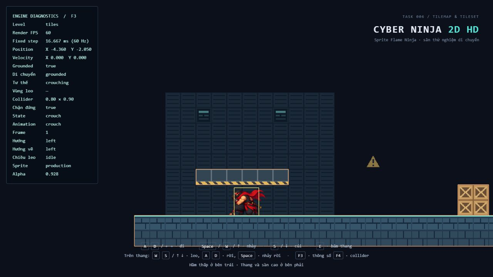
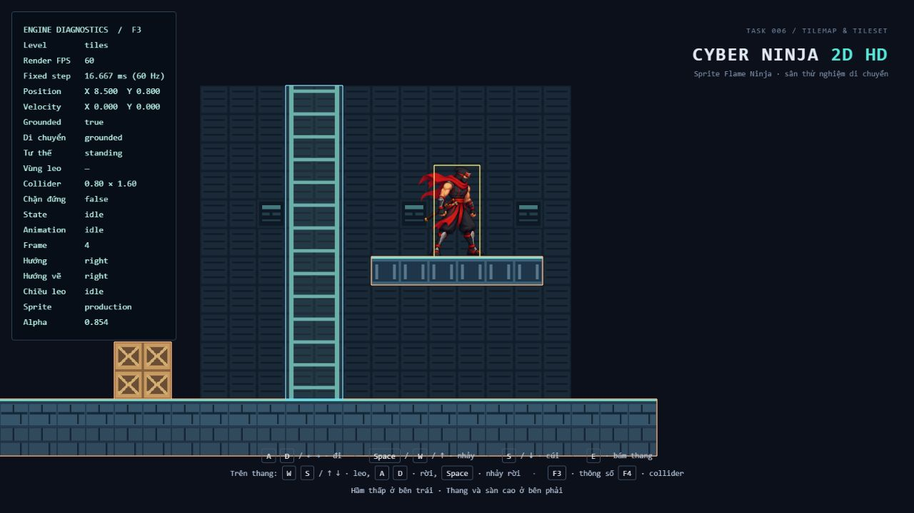
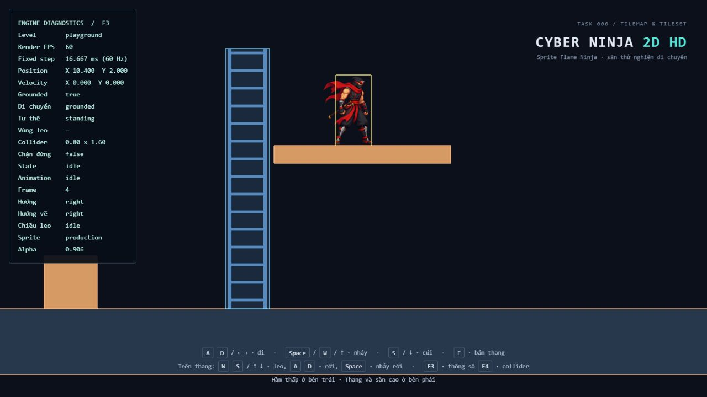
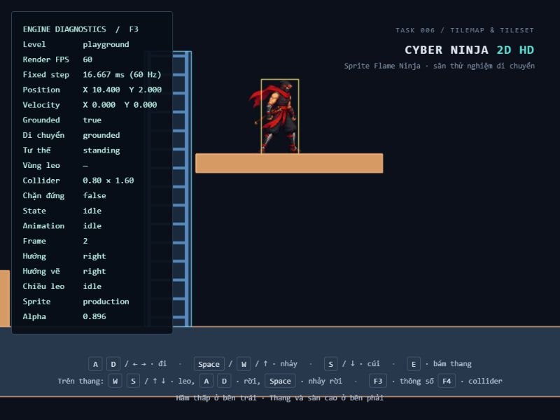
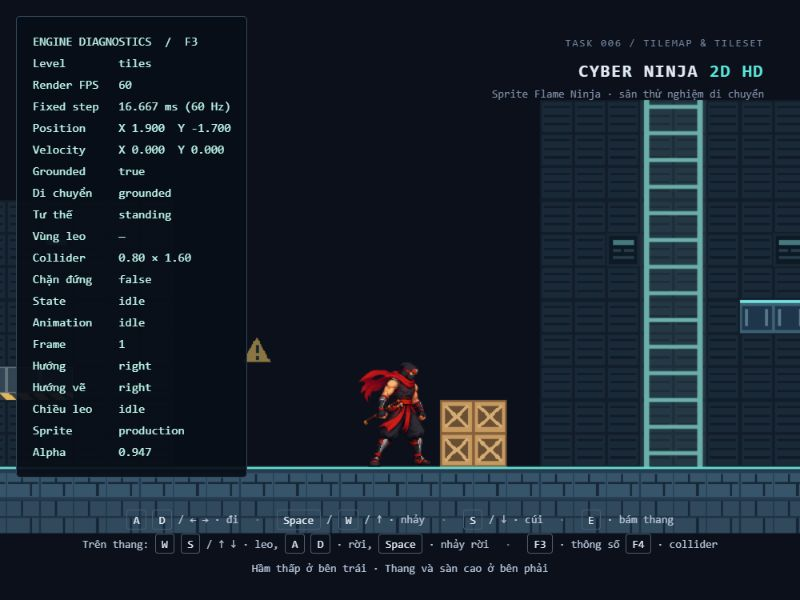

# Task 006 — Tilemap & Tileset Foundation

## Phạm vi

Đã đọc hướng dẫn AGENTS.md người dùng cung cấp, `docs/TASK-004.md`, `docs/TASK-005.md` và các module level, Game, sprite/texture renderer, physics/collision, Player cùng test liên quan trước khi sửa. Không tìm thấy AGENTS.md khác trên đĩa trong project hoặc các thư mục cha đã tra cứu. Áp dụng quy tắc sửa tối thiểu, không refactor ngoài phạm vi, không lint/formatter.

Thêm tilemap trực giao hữu hạn, một atlas và các layer hình ảnh; giữ schema level version 1 bằng trường `tilemap` tùy chọn. `playground.json` và `small.json` không sửa. Collision và climbable vẫn là các hình chữ nhật khai báo tường minh theo Task 005, không sinh tự động từ tile. Cách này phù hợp PhysicsWorld hiện có và giữ collider nhân vật 0.8 × 1.6 / 0.8 × 0.9.

Không sửa sprite/atlas nhân vật, pivot, animation leo, timestep, input, camera hoặc movement/physics. Không thêm dependency, editor, Map 1 production, combat, AI, checkpoint hay respawn.

## File thay đổi

| File | Nội dung |
| --- | --- |
| `src/world/TilemapData.ts` (mới) | Schema tilemap, parser/validation, chuyển tọa độ ô sang world |
| `src/rendering/TilemapRenderer.ts` (mới) | Tải/kiểm atlas, UV, gom mesh theo layer, quản lý tài nguyên/lifecycle |
| `src/world/LevelData.ts` | Tilemap tùy chọn; chuẩn hóa/kiểm tra structureOpacity của ladder |
| `src/world/TestLevel.ts` | Kết nối tile renderer, tải visual, truyền opacity cho ray và bậc |
| `src/core/Game.ts` | Hàm `loadLevelVisuals()` trước khi bắt đầu chạy |
| `src/main.ts` | Chờ tải atlas trước start, dispose và báo rõ lỗi tải |
| `src/world/levels/tiles.json` (mới) | Màn thử grid 40 × 16, hai layer, spawn/collider/vùng leo riêng |
| `src/world/levels/index.ts` | Đăng ký tên `tiles` cùng playground/small |
| `public/assets/environments/test-tileset.svg` (mới) | Atlas thử tự vẽ, 128 × 64 px |
| `public/assets/environments/README.md` (mới) | Nguồn asset, ID và hướng dẫn thay ảnh |
| `tests/TilemapData.test.ts` (mới) | 49 trường hợp schema, tọa độ, opacity, tương thích và physics |
| `tests/TilemapRenderer.test.ts` (mới) | 6 trường hợp mesh/UV/layer, lỗi ảnh và lifecycle |
| `tests/LevelData.test.ts` | Thêm structureOpacity=1 vào kết quả chuẩn hóa mặc định mong đợi |
| `index.html`, `README.md` | Nhãn/link Task 006 |
| `docs/TASK-006.md`, `docs/task-006-*.png` | Báo cáo và ảnh nghiệm thu |

Các test Task 005 về playground tiếp tục dùng mốc AABB literal độc lập; bổ sung mốc literal cho toàn bộ hình học và spawn small. Không thay expected physics để khớp một hành vi mới.

## Schema grid và atlas

Một level vẫn cần `version`, `id`, `spawn`, `solids`, `climbables`, `visuals` như Task 005. Có thể thêm fragment `tilemap` sau:

```json
{
  "tilemap": {
    "origin": { "x": -2, "y": 3 },
    "columns": 2,
    "rows": 2,
    "tileSize": { "width": 0.5, "height": 1 },
    "tileset": {
      "image": "assets/environments/test-tileset.svg",
      "imageWidth": 128,
      "imageHeight": 64,
      "tileWidth": 32,
      "tileHeight": 32
    },
    "layers": [
      { "id": "background", "opacity": 0.6, "cells": [[5, null], [5, 6]] },
      { "id": "terrain", "cells": [[null, null], [0, 1]] }
    ]
  }
}
```

Fragment này minh họa hình ảnh; collision phải khai báo riêng trong level nếu cần. Ý nghĩa:

- `origin`: góc trên trái của toàn lưới trong world. Column tăng sang phải, row tăng xuống dưới. Các hàng `cells[row][column]` theo đúng thứ tự đó.
- `columns`, `rows`: số nguyên dương. Mỗi layer phải có đúng số hàng và mỗi hàng đúng số cột; không tự pad/cắt dữ liệu.
- `tileSize`: kích thước tile trong world unit, không phụ thuộc kích thước nhân vật hoặc số pixel atlas. Tile có thể không vuông.
- `tileset`: một ảnh atlas có kích thước pixel tường minh; ảnh chia đều cho `tileWidth`/`tileHeight`, không margin/spacing. Số cột atlas được suy từ imageWidth/tileWidth.
- ID tile là số nguyên bắt đầu từ **0**, tăng trái sang phải rồi xuống hàng trong atlas. **`null` là ô trống**; 0 là tile đầu tiên, không phải ô trống. Không dùng -1, chuỗi hay phần tử thiếu để thay null.
- `layers` xếp từ sau ra trước. ID layer phải không rỗng và không trùng. `opacity` layer thuộc 0..1, mặc định 1. Tất cả layer hiện nằm sau nhân vật; chưa có foreground che nhân vật.

Công thức tâm tile:

```text
worldX = origin.x + (column + 0.5) * tileSize.width
worldY = origin.y - (row + 0.5) * tileSize.height
```

Ví dụ fragment trên: ô [0][0] có tâm (-1.75, 2.5), ô [1][1] có tâm (-1.25, 1.5). Collider/vùng leo vẫn dùng tọa độ tâm AABB theo world, không dùng chỉ số grid.

Validation từ chối object/field bắt buộc thiếu hoặc sai kiểu, NaN/Infinity, kích thước không dương, số hàng/cột không nguyên an toàn, biên lưới tràn số, kích thước atlas không chia hết, ID tile ngoài atlas, layer trùng ID và ma trận sai kích thước. Giới hạn kỹ thuật: 1..8 layer, tổng columns × rows × layers không quá 65536 ô, tính cả null. Lỗi chỉ đúng vị trí, ví dụ `tilemap.layers[0].cells[1][1] phải là null hoặc ID tile nguyên 0..7`. Không có tilemap thì dùng level cũ; `tilemap: null` tường minh là dữ liệu sai. Parser sao chép dữ liệu cần dùng.

## Render, tải ảnh và collision

TilemapRenderer tạo tối đa một mesh cho mỗi layer có ô không trống, dùng chung một texture trong level. Mỗi tile có quad/UV riêng trong BufferGeometry; layer rỗng không tạo mesh. Z lần lượt -0.5, -0.49… vẫn sau visual hình chữ nhật cũ Z=0 và player Z=1. Dùng sRGB, nearest filter, không mipmap và inset nửa texel trong UV để tránh lấy pixel từ ô kế cận. Không dùng alpha/ID tile để quyết định collision.

Game khởi tạo hình học/physics rồi `main.ts` chờ `game.loadLevelVisuals()` hoàn tất trước `game.start()`. Nếu dùng Game trực tiếp cho level tile, caller cũng cần chờ hàm này trước start. Level cũ không có atlas cần tải nên bước này hoàn tất ngay. Asset nhân vật vẫn do luồng cũ tải riêng.

Kích thước ảnh thực phải đúng metadata; đường dẫn ảnh hỏng hoặc kích thước sai tạo lỗi rõ ràng và dừng khởi tạo game, không dùng texture fallback. Khi lỗi khởi động async, main dispose Game rồi hiển thị nguyên nhân. Tải đồng thời nhiều lần dùng cùng promise, không tạo request/mesh trùng. Khi dispose/HMR trong lúc tải, ảnh đến muộn được giải phóng, không gắn lại mesh hoặc đưa lỗi cũ vào trang mới. Geometry/material của từng layer và texture dùng chung được giải phóng khi dispose. Tải lỗi cần reload sau khi sửa dữ liệu/asset; không có retry tự động.

`solids`/`climbables` tiếp tục đi trực tiếp vào PhysicsWorld. Vẽ thêm tile nền, bỏ hết tile hoặc đổi atlas không thay AABB. Level thử chủ động chọn visual terrain khớp bốn AABB của nó, được test như một kiểm tra dữ liệu của màn thử; đây không phải quy tắc tự suy collider cho mọi level. Ray/bậc thang chỉ là visual. Không có yêu cầu collision mơ hồ cần tạo một luật physics mới trong task này.

## Opacity ladder

Giữ nghĩa tương thích của trường cũ:

| Visual | Trường | Áp dụng |
| --- | --- | --- |
| rectangle | `opacity`, mặc định 1 | Cả rectangle |
| ladder | `opacity`, mặc định 1 | Rectangle nền của vùng leo |
| ladder | `structureOpacity`, mặc định 1 | Cả hai ray và mọi bậc |

`structureOpacity` được kiểm số hữu hạn thuộc 0..1. Ví dụ `opacity: 0.2, structureOpacity: 0.35` cho nền 0.2 và ray/bậc 0.35. Cả hai thành phần dùng transparent/depthWrite phù hợp opacity. Không đổi nghĩa `opacity` thành độ mờ toàn bộ ladder vì sẽ làm thang playground cũ mờ đi. Dữ liệu playground và small không đổi: nền vẫn 0.2, ray/bậc vẫn 1. Có test cho mặc định ở cả hai level, cấu hình ray/bậc riêng và giá trị lỗi.

## Asset và level thử

`test-tileset.svg` được tự vẽ bằng các shape SVG cho task này, không lấy asset bên thứ ba, không dùng ảnh AI. Đây là asset chức năng đơn giản; không xem là hướng nghệ thuật Map 1. Có 8 tile 32 × 32 px trong atlas 4 × 2: mặt sàn, thân sàn, thùng, mái vạch vàng, sàn cao, panel nền, panel đèn, biển cảnh báo trong suốt. Xem `public/assets/environments/README.md` để tra ID và thay ảnh.

Level `tiles` có origin (-8, 4.5), tile world 0.5 × 0.5, grid 40 × 16, hai layer background/terrain. Spawn (0, 1.8). Hình học:

| Hình | Tâm X/Y | Rộng × cao |
| --- | --- | --- |
| Floor | 2 / -3 | 20 × 1 |
| Block | 3 / -2 | 1 × 1 |
| Roof | -4.5 / -1.25 | 3 × 0.5 |
| Platform | 8.5 / -0.25 | 3 × 0.5 |
| `tiles-ladder` | 6 / 0.25 | 1 × 5.5 |

Mặt đất -2.5; khoảng hầm 1.0 vừa collider cúi 0.9, chặn collider đứng 1.6; mặt sàn cao 0. Có 96 ô terrain không trống khớp bốn solid: 80 sàn, 4 block, 6 mái, 6 platform. Background có 232 ô trang trí không sinh solid. Ladder vẫn dùng builder Task 005, spacing 0.4 nên không cần đổi animation hiện tại.

Để tạo level khác: sao chép JSON, thay id/spawn, khai báo AABB solid và vùng leo trong world, điền ma trận layer rồi import/đăng ký trong `src/world/levels/index.ts`. Mở `?level=<tên registry>`. Có thể để `visuals: []` nếu chỉ dùng tile; vẫn cần trường này để giữ schema Task 005. Khi chỉ thay artwork, đặt atlas mới trong public, cập nhật image/kích thước pixel/ID tile, giữ tileSize world và physics nếu muốn giữ hành vi. Chưa hỗ trợ Tiled import, tile flip/rotation, tile animation, margin/spacing hoặc nhiều atlas.

## Test và build thực tế

Dùng Node bundled **24.22.1**, không thay package/lockfile. Chạy các script hiện có:

- Lượt đầu `npm run test`: 221 qua, 1 lỗi. Test rời thang sau khi leo xuống đúng cao độ mặt sàn đã bỏ qua việc nhân vật rơi trong lúc đi qua khoảng hở; sửa setup test leo lên lại trước khi rời. Không sửa physics hoặc collider để làm test qua.
- Lượt đầu `npm run build`: TypeScript báo container có thể null trong hàm báo lỗi mới. Sửa hàm nhận HTMLElement đã được kiểm tra ở caller.
- Lượt chạy lại `npm run test`: **222/222 test qua, 20/20 file qua**, exit 0, 4.62 s. Gồm 167 test cũ + 55 mới. Vitest có gợi ý hiệu năng về 20 worker/isolation, ước tính tiết kiệm ít nhất khoảng 596 ms khi tắt isolation; không thay config ngoài phạm vi.
- Lượt chạy lại `npm run build`: **thành công**, exit 0, TypeScript strict + Vite 8.3.5, 31 module; Vite build 1.24 s. HTML 1.27 kB (gzip 0.70), CSS 1.52 kB (gzip 0.70), JS 571.07 kB (gzip 143.82).
- Build có cảnh báo không chặn **chunk JavaScript lớn hơn 500 kB**; chưa code-split vì ngoài phạm vi nền tảng tilemap này. Không chạy lint/formatter.

Test mới bao phủ parser/field bắt buộc/dữ liệu sai và đường dẫn lỗi, ID 0/null, tile không vuông, chuyển tọa độ, layer/order/default/clone, opacity ladder, AABB/spawn level cũ, dữ liệu collision/climbable của tiles, headroom/leo/rời bằng cùng PhysicsWorld. Renderer test kiểm UV hàng trên/dưới, tọa độ quad, bỏ null, batch/layer rỗng, texture filter, deduplicate load, sai kích thước ảnh, lỗi tải và dispose cả lúc đang tải. Unit test không tạo WebGL; phần hiển thị kiểm riêng dưới đây.

## Nghiệm thu trình duyệt

Điều khiển bằng bàn phím qua trình duyệt in-app; đọc F3/F4 và quan sát screenshot. Không sửa state/teleport trong trang để thay cho thao tác. Dev server hiện có tại 5174. Production build được phục vụ bằng `npm run preview -- --host 127.0.0.1 --port 4174 --strictPort`, có HTTP 200 và đã mở đúng URL 4174. Lượt preview đầu trong sandbox không truy cập được; đã dừng rồi mở preview ngoài sandbox để kiểm tra. Preview riêng dùng cho nghiệm thu được dừng sau khi xong; dev server có sẵn được giữ.

| Môi trường / trường hợp | Kết quả thực tế |
| --- | --- |
| Dev tiles: khởi động | Level tiles, sprite production, X=0, Y=-1.7 sau rơi; atlas, panel nền, biển trong suốt, mái, thùng và nền sàn hiển thị |
| Dev tiles: S+A vào mái, nhả cúi | X=-4.36, Y=-2.05; crouching 0.8 × 0.9, chặn đứng=true |
| Dev tiles: Space dưới mái rồi D ra | Space không xuyên mái; sau ra X=-0.3, Y=-1.7, đứng lại 0.8 × 1.6 |
| Dev tiles: chạy tới block, D+Space | Bị chặn tại X=2.1, sau nhảy qua X=5.4 và đáp đất |
| Dev tiles: D tới thang, W+E rồi S | X=6; leo lên Y=0.353, xuống Y=-0.207, clip Up/Down đúng |
| Dev tiles: nhả giữa thang | Down frame 3 và Y=-0.207 giữ nguyên qua hai lần quan sát |
| Dev tiles: W tới đỉnh, D sang sàn | Đỉnh tâm Y=2.2; rời thang đáp X=8.5, Y=0.8, grounded=true, chân Y=0 |
| Production playground: S+A vào hầm, nhả, D ra | Trong hầm X=-4.12, Y=-2.05, chặn đứng=true; ra X=0.1, Y=-1.7, đứng lại |
| Production playground: chạy và nhảy vật cản | Chặn tại X=3, nhảy qua X=7 và đáp đất |
| Production playground: facing trái, W+E rồi S | X=8; Up tại Y=0.307, Down tại Y=-0.3; hướng vẽ phải, không flip lúc leo |
| Production playground: nhả rồi leo lên/rời | Down frame 3/Y=-0.3 giữ qua hai quan sát; lên đỉnh Y=2.6; D sang sàn X=10.4, Y=2.0, grounded=true |
| Production tiles: tải atlas, đi, resize và nhảy | Atlas hiện đúng; đi tới X=1.9; sau resize D+Space tới X=5.4, grounded=true |
| Production small: mở và rơi từ spawn | X=-2, Y=-1.7 sau đáp; hình học/màu/nền thang và ray/bậc như Task 005 |
| Resize production playground và tiles | 1280 × 720 → 800 × 600 → trở lại; canvas DOM đo đúng 800 × 600, hình cập nhật, tọa độ body giữ nguyên khi đứng; input tiếp tục hoạt động sau resize tiles |
| Console | Các tab tiles dev, playground production, tiles production và small production không ghi nhận warning/error tại lúc đọc log |

Ảnh resize cho thấy phần world nhìn ngang thay đổi theo aspect; tile không bị kéo giãn độc lập so với nhân vật. FPS thường 60, có lúc 45–50 quanh resize; fixed step vẫn 16.667 ms. Không khẳng định benchmark 60 FPS ở mọi thiết bị. Viewport override đã reset sau kiểm tra.











## Chưa kiểm tra và giới hạn

Chuỗi thao tác đầy đủ ở tiles thực hiện trên dev; production tiles đã kiểm tải atlas, đi/nhảy và resize, chưa lặp lại toàn bộ chuỗi hầm/leo. Playground thực hiện chuỗi đầy đủ trên production. Small trong task này chỉ kiểm mở/spawn/appearance thực tế; hành vi chi tiết còn được bảo vệ bằng test cũ, chưa chơi lại toàn bộ small. Chưa kiểm mọi tổ hợp phím, giữ hai đầu thang hoặc Space rời thang trong Task 006; các cơ chế này không sửa và test hiện có vẫn qua.

Lỗi dữ liệu/ảnh sai được thử bằng unit test, chưa cố tình làm hỏng asset runtime qua trình duyệt. Chưa kiểm mạng chậm thực tế, HMR khi đang tải ảnh ngoài các test lifecycle, DPR khác 1, trình duyệt khác hoặc thiết bị vật lý. Chưa có screenshot regression tự động/video/đo foot contact pixel. Không sửa độ nghiêng ngang và trượt tay/chân trong atlas leo đã nêu ở Task 005.

Schema chỉ hỗ trợ grid hữu hạn trực giao và layer sau nhân vật, chưa có streaming/chunk culling hoặc editor. Mỗi layer có một mesh cho toàn level; giới hạn ô là guard kỹ thuật, không phải cam kết hiệu năng cho mọi dữ liệu. Atlas thử đơn giản có thể thay sau. Tọa độ dùng number trong dữ liệu và Float32 trong GPU; chưa có floating-origin cho world rất lớn. Collision vẫn AABB tĩnh, không slope/one-way/moving platform, không tự tạo collider từ tile. Ground hữu hạn và không có respawn.
