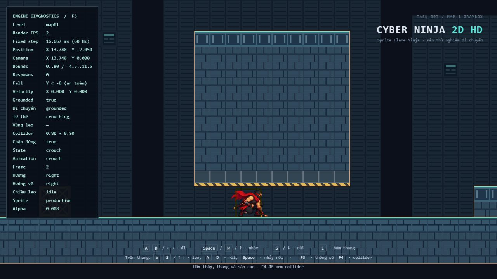
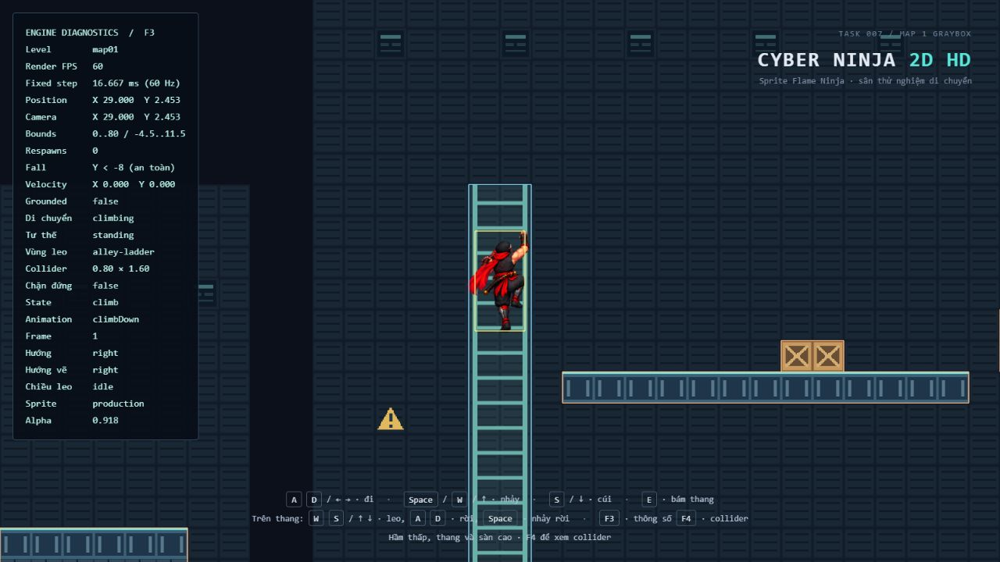
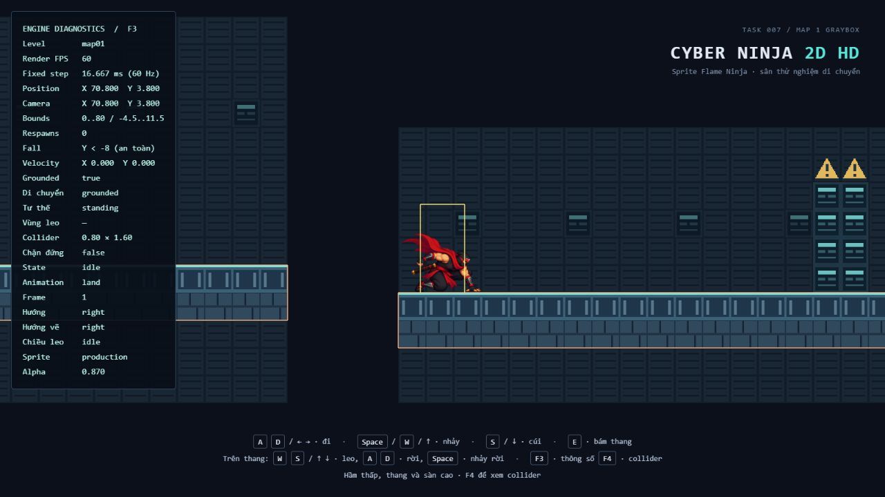
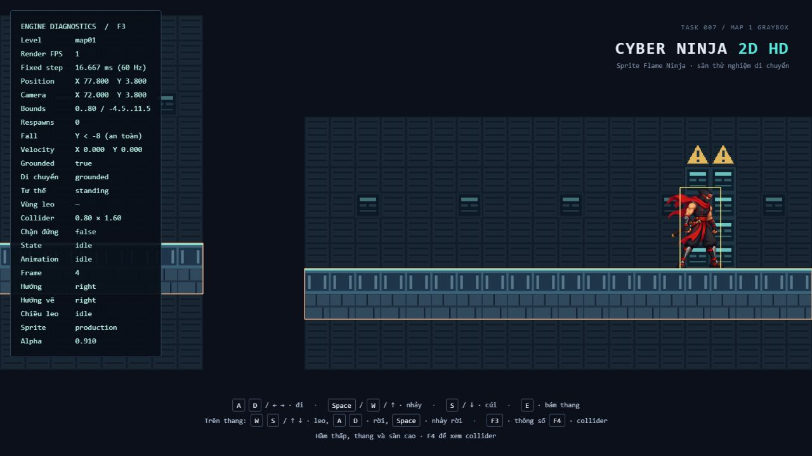
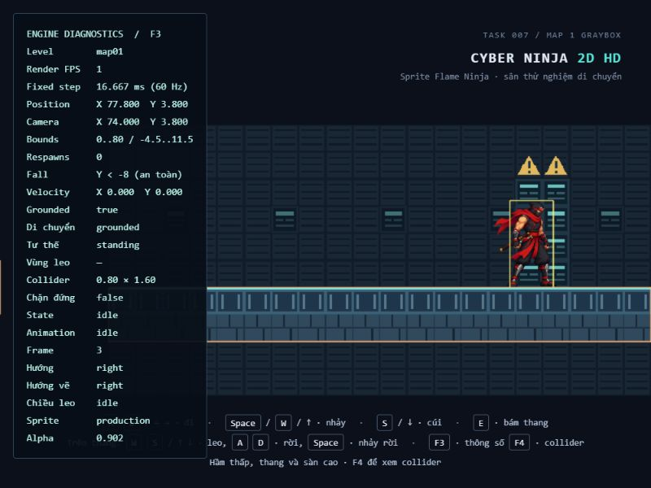
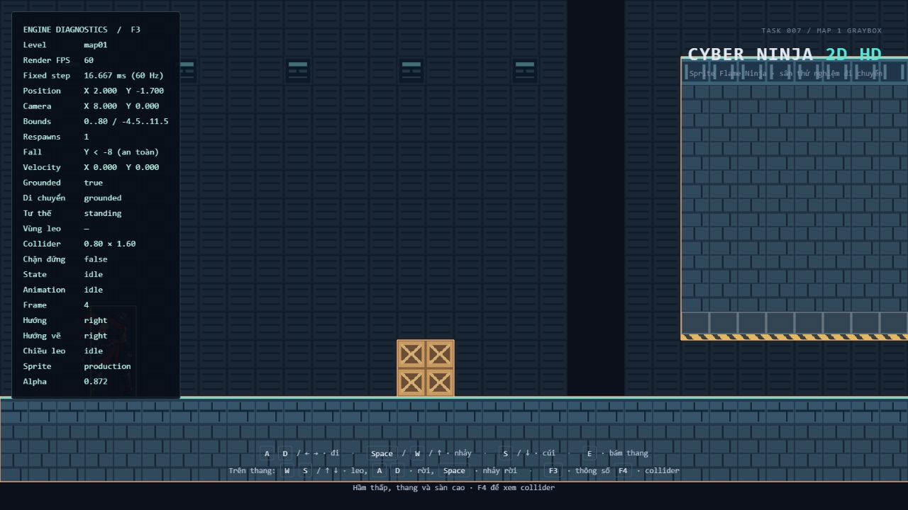

# Task 007 — Map 1 Graybox, Camera & Level Boundaries

## Phạm vi và hướng dẫn

Tiếp nối Task 006 tại project hiện có. Đã đọc tài liệu Task 005/006 và kiểm tra Game, GameLoop, GameCamera, TilemapRenderer, LevelData, TilemapData, TestLevel, registry, Player, movement controller, animator, PhysicsWorld, config, input/debug và test liên quan trước khi sửa. Không tìm thấy AGENTS.md khác trên đĩa trong project hoặc các thư mục cha đã tra cứu; áp dụng AGENTS.md người dùng đã cung cấp trong cuộc trò chuyện. Test và build được Task 007 cho phép; không chạy lint hoặc formatter.

Kết quả là Map 1 graybox chơi được bằng cơ chế cũ, camera có bounds tùy level và hồi về spawn khi rơi. Không thay timestep, các tham số movement/physics, thuật toán collision, sprite/pivot/scale, logic chuyển hướng leo, tile renderer hoặc asset. Không thêm dependency, artwork production, combat, AI, checkpoint, máu/mạng, audio, menu hay chuyển màn.

## File tạo mới và sửa

| File | Thay đổi |
| --- | --- |
| `src/world/levels/map-01-graybox.json` (mới) | Dữ liệu Map 1, ba zone, camera/fall boundary, ba layer tile, collider và ladder |
| `scripts/generate_map01.mjs` (mới) | Công cụ authoring cố định cho graybox này; tạo JSON lặp lại được |
| `src/world/levels/index.ts` | Đăng ký `map01`; giữ các entry cũ |
| `src/world/LevelData.ts` | Kiểu CameraBounds và ba field tùy chọn, validation |
| `src/world/TestLevel.ts` | Truyền cameraBounds/cameraFollowY/deathY đã đọc cho Game |
| `src/rendering/GameCamera.ts` | Follow vị trí nội suy, clamp theo viewport, resize, reset và chế độ dọc tùy chọn |
| `src/core/FallRecovery.ts` (mới) | Kiểm biên, điều phối reset player/input/camera và đếm lần hồi sinh, kiểm thử không cần DOM/WebGL |
| `src/core/Game.ts` | Nối cấu hình camera và FallRecovery vào update/render hiện có |
| `src/entities/PlayerMovementController.ts` | Hàm reset trạng thái/collider/vận tốc, chỉ gọi khi respawn |
| `src/entities/PlayerAnimator.ts` | Hàm reset hướng và clip Fall, chỉ gọi khi respawn |
| `src/entities/Player.ts` | Hàm respawn dùng reset movement/animation và setPosition hiện có |
| `src/debug/DebugOverlay.ts` | Vị trí camera, bounds, số lần hồi sinh và trạng thái fall boundary |
| `tests/BoundedCamera.test.ts` (mới) | 8 test camera |
| `tests/FallRecovery.test.ts` (mới) | 4 trường hợp hồi sinh, input, interpolation, animation và camera |
| `tests/Map01.test.ts` (mới) | 27 trường hợp schema, tương thích, collision/tile và đi toàn tuyến |
| `index.html`, `README.md` | Nhãn Task 007, hướng dẫn hiện tại; bỏ hướng trái/phải cố định trong chú thích hầm/thang vì Map 1 bố trí khác |
| `docs/TASK-007.md`, `docs/task-007-*.png` | Báo cáo và ảnh ba zone/đích/resize/respawn |

Không sửa `playground.json`, `small.json`, `tiles.json`, test Task 001–006, package hoặc lockfile. Project hiện không có Git repository; không tạo commit hoặc thực hiện dọn code ngoài phạm vi.

## Layout Map 1

Màn liền mạch trong một file, rộng **80 world unit = 5 viewport chuẩn 16 unit**, tiến chủ yếu trái sang phải. Đây là blockout lối chơi cho khu phố đô thị Việt Nam về đêm; panel/tile hiện tại chỉ là placeholder, chưa có mặt tiền/biển hiệu/đặc trưng kiến trúc Việt Nam hoàn thiện.

| Zone | Khoảng X | Lối chơi |
| --- | --- | --- |
| A — Street Entrance | 0..26 | Spawn an toàn, đoạn chạy, thùng tại 7..8, hầm 12..17, bậc 21..24 |
| B — Back Alley | 26..40 | Thang tại X=29, ban công 30..36.5, thùng nhỏ trên ban công, bước nhảy lên mái tại X=37 |
| C — Rooftop Escape | 40..80 | Bốn mặt mái liên tiếp, ba khoảng hở 2 unit, thay đổi độ cao, cột đích cyan khoảng X=78 |

Spawn là tâm body **(2, -1.7)**, chân nằm trên mặt đường Y=-2.5. Đường dưới chạy X=0..40. Hầm có đáy mái Y=-1.5, tạo khoảng trống **1.0 unit**: collider cúi cao 0.9 đi qua, collider đứng cao 1.6 bị chặn. Khối phía trên hầm cao tới Y=3.5 để không thể đơn giản nhảy vượt cả lối cúi từ mặt đường. Bậc nhỏ cao 1 unit so với đường.

Thang `alley-ladder` có tâm (29, 0.75), rộng 1, cao 6.5, từ Y=-2.5 tới 4. Tâm nhân vật được leo trong -1.7..3.2 bằng đúng controller hiện có. Ban công có mặt Y=1; có thể rời thang khi đủ cao rồi đáp lên ban công. Thùng trên ban công cao 0.5. Mái đầu có mặt Y=2, cao hơn ban công 1 unit.

| Mái | Khoảng X | Mặt trên Y | Chuyển từ mái trước |
| --- | --- | --- | --- |
| upper-roof | 37..48 | 2 | Nhảy từ ban công qua khoảng hở 0.5 |
| roof-2 | 50..58 | 3 | Gap 2, lên 1 |
| roof-3 | 60..68 | 3.5 | Gap 2, lên 0.5 |
| roof-4 | 70..80 | 3 | Gap 2, xuống 0.5 |

Cột cyan/biển tạm ở X=77.5..78.5 chỉ là điểm đích nhìn thấy. Không có trigger thắng, chuyển level hoặc tương tác mới. Có thể đi khỏi mép cuối rồi được hồi sinh.

### Kiểm chứng khả năng nhảy

Giữ runSpeed=6, jumpVelocity=11, gravity=-28, collider đứng 0.8 × 1.6. Theo chuyển động liên tục, đỉnh nhảy cao 11²/(2×28) ≈ **2.16 unit**; tầm ngang cùng độ cao ≈ **4.71 unit**. Tầm ngang lý thuyết khi đáp cao hơn 1 / 0.5 / thấp hơn 0.5 lần lượt khoảng 4.08 / 4.42 / 4.97 unit. Các gap 2 unit có chỗ lấy đà và tiếp đất, không cần wall jump hoặc double jump.

Không chỉ dựa vào các công thức này: test đi toàn tuyến dùng đúng tích phân, sweep và input ở **1/60 s**, vượt thùng, hầm, bậc, leo, rời lên ban công, nhảy lên mái rồi qua cả ba gap tới X=77. Test kiểm canOccupy từng bước và tiếp đất đúng mặt mái; không teleport giữa các zone trong test toàn tuyến. Các test hồi sinh riêng có setup vị trí/trạng thái để kiểm reset.

## Tilemap và collision

Tái sử dụng `test-tileset.svg` Task 006 nguyên vẹn, không thêm artwork. Map dùng grid **160 × 32**, tile world **0.5 × 0.5**, origin **(0, 11.5)**. Ba layer: background (opacity 0.55), terrain, markers. Tổng 15360 ô khai báo, dưới giới hạn schema hiện có. Null vẫn là ô trống; ID 0 vẫn là tile đầu tiên.

Có **10 solid AABB tường minh và 1 climbable**. Terrain được author khớp biên AABB theo lưới 0.5; test đếm diện tích tile của từng solid và kiểm không solid nào chồng nhau. Panel nền và cột đích không thêm collision. Ladder vẫn do visual builder cũ dựng, spacing 0.4, nền opacity 0.12 và ray/bậc opacity 1. Không thay khoảng đường animation leo.

Script authoring lấy danh sách AABB tường minh làm nguồn để tô terrain lúc tạo JSON; đây là công cụ tạo dữ liệu riêng của màn này. Runtime chỉ đọc JSON, không suy collider từ tile hoặc sinh collider trùng. Texture loading/disposal và batch theo layer giữ nguyên TilemapRenderer Task 006.

Để chỉnh graybox có thể sửa `scripts/generate_map01.mjs` rồi chạy `node scripts/generate_map01.mjs`; lệnh ghi lại file `map-01-graybox.json`. Có thể sửa JSON trực tiếp nhưng lần chạy generator sau sẽ thay nội dung theo script. Đây không phải editor hoặc pipeline map production.

## Schema bổ sung, vẫn version 1

```json
{
  "cameraBounds": { "minX": 0, "maxX": 80, "minY": -4.5, "maxY": 11.5 },
  "cameraFollowY": true,
  "deathY": -8
}
```

Cả ba trường đều tùy chọn và không được tự chèn vào level cũ:

- `cameraBounds`: object bốn tọa độ hữu hạn, minX < maxX, minY < maxY và kích thước hữu hạn. Tâm spawn phải ở trong bounds nếu cấu hình trường này. Sai kiểu/thiếu tọa độ/null đều báo lỗi, không fallback.
- `cameraFollowY`: boolean; vắng mặt tương đương không theo dọc. Có thể bật theo dọc mà không có bounds. `false` tường minh hợp lệ; chuỗi `"true"` hoặc null không hợp lệ.
- `deathY`: số hữu hạn, phải **thấp hơn tâm spawn** để spawn không tự kích hoạt hồi sinh lặp. Trigger khi tâm body **nhỏ hơn** deathY, không phải khi bằng. Không bắt buộc deathY trùng biên camera; Map 1 đặt dưới đáy camera để nhân vật rơi ra khỏi khung trước khi hồi lại.

Kiểm tra spawn không chồng solid tiếp tục dùng collider đứng hiện tại và `PhysicsWorld.canOccupy` trong Game trước khi tạo WebGL. Không ép spawn mọi level phải đứng trên sàn, vì level cũ bắt đầu rơi từ trên cao. Map 1 chủ động đặt spawn ngay trên đường và có test xác nhận.

Ví dụ lỗi có đường dẫn: `cameraBounds.minX phải là số hữu hạn`, `deathY phải thấp hơn tâm spawn để tránh hồi sinh lặp`, `spawn phải nằm trong cameraBounds`. Cấu hình không hợp lệ dừng khởi tạo, không tự sửa data.

## Camera và biên

Game truyền **player.visual.position sau syncVisual(alpha)** cho camera, không lấy vị trí body thô. Không thêm smoothing: việc bám trực tiếp vị trí visual đã nội suy tránh thêm độ trễ và không phụ thuộc tần số render. Clamp liên tục theo viewport, không lượng tử hóa tọa độ hoặc sửa body.

Nếu map rộng hơn viewport, tâm camera X giới hạn trong `[minX + halfWidth, maxX - halfWidth]`. Y dùng công thức tương tự với halfHeight khi có bounds. Nếu kích thước map nhỏ hơn hoặc bằng viewport trên một trục, đặt tâm tại trung điểm bounds trên trục đó; không clamp với min lớn hơn max. Không thu nhỏ/zoom camera để cố lấp phần ngoài map ở trường hợp viewport lớn hơn toàn map.

Chiều cao nhìn vẫn 9 unit. Ở 1280 × 720, viewport rộng 16 nên Map 1 clamp X=8..72; ở 800 × 600, rộng 12 nên X=6..74. Bounds Y=-4.5..11.5 cho tâm camera Y=0..7. Khi resize, projection cập nhật và clamp lại ngay; render kế tiếp tiếp tục follow visual. Level cũ không bounds/followY vẫn bám X với Y=0, kể cả khi nhảy.

`reset(position)` đặt camera ngay về target đã clamp; dùng lúc khởi tạo và hồi sinh. Không kéo camera từ điểm chết về spawn. CameraBounds là biên khung nhìn, không phải tường vật lý: người chơi có thể đi khỏi mép nền và rơi xuống deathY nếu level có cấu hình.

## Fall recovery

FallRecovery được gọi sau movement/physics trong mỗi fixed update. Nếu vượt deathY:

1. Movement reset: activeClimbable=null, stance standing, standingBlocked=false, collider 0.8 × 1.6, vận tốc X/Y=0, grounded=false.
2. Animator reset: facing phải, không còn hướng vẽ/trạng thái leo, playback speed=1, Fall restart tại frame đầu. Tick sau ở spawn trên nền có thể Land rồi Idle bình thường; không reload sprite.
3. SetPosition về spawn bằng hàm hiện có, reset cả previous position/height và visual interpolation. Alpha 0, 0.5 hay 1 đều không nội suy qua quãng đường rơi.
4. Xóa held key và input edges qua InputManager.reset. Key repeat của phím đang giữ bị InputManager hiện có bỏ qua, cần nhấn mới để tiếp tục đi/nhảy.
5. Reset camera theo visual spawn và tăng bộ đếm một lần. Game kết thúc phần xử lý bước hồi sinh đó; bước tiếp theo dùng state mới.

Không có deathY thì FallRecovery không làm gì. Bộ đếm chỉ thuộc instance Game đang chạy; reload đổi phiên sẽ về 0. Cấu hình có tâm spawn ở hoặc dưới deathY bị từ chối từ trước, tránh vòng hồi sinh lặp do cấu hình này.

F3 chỉ đọc và hiển thị level, player/camera position, bounds, respawn count và điều kiện `Y < deathY` hoặc `tắt`. F4 giữ collider debug cũ. Overlay không tham gia quyết định mô phỏng.

## Test và build thực tế

Chạy với Node bundled **24.22.1**; không đổi dependency hoặc cấu hình test/build.

- Lượt đầu `npm run test`: **260 qua, 1 lỗi**. Helper test đi tới X=20 đã yêu cầu equality trong 0.005 dù input 60 Hz có bước ngang 0.1 và đoạn cúi tạo offset 0.02. Đổi kiểm tra helper sang khoảng `[target, target + một bước chạy]`; không đổi physics/data để làm test qua.
- Lượt chạy lại `npm run test`: **261/261 test qua, 23/23 file qua**, exit 0, 2.00 s. Giữ 222 test cũ và thêm 39 trường hợp mới. Vitest in gợi ý tối ưu isolation/23 worker, ước tính nhanh hơn ít nhất khoảng 333 ms nếu tắt isolation; giữ config hiện tại.
- Build lần đầu và lần cuối đều thành công. Lần cuối `npm run build` (**tsc --noEmit && vite build**): exit 0, 33 module, Vite 8.3.5 build 572 ms. HTML 1.25 kB (gzip 0.69), CSS 1.52 kB (gzip 0.70), JS **644.67 kB (gzip 146.36)**.
- Còn cảnh báo chunk JS lớn hơn 500 kB, không chặn build. Registry import dữ liệu map tĩnh; chưa tách chunk/data tải riêng vì ngoài phạm vi này. Không chạy lint, ESLint, Prettier hoặc formatter.

Các test camera bao gồm legacy, X clamp, Y bật/tắt/clamp, resize, map nhỏ hơn viewport, viewport rộng hơn map, bám vị trí nội suy không sửa body, liên tục qua điểm clamp và reset tức thời. Test dữ liệu bao gồm bounds sai, NaN/Infinity/tràn span, kiểu boolean sai, deathY sai, spawn ngoài bounds/chồng solid và field tùy chọn vắng mặt ở cả ba level cũ. Test recovery kiểm từ crouch và climbing, active reference, collider, vận tốc, animation, sprite root/height/interpolation ở ba alpha, input/repeat, camera, rơi qua gap thật và không hồi sinh lặp trong 180 bước tại spawn. Không cần WebGL cho các test này.

## Nghiệm thu trình duyệt thực tế

Dev server được mở bằng `npm run dev -- --host 127.0.0.1 --port 5174 --strictPort`; HTTP trả 200. Mở `http://127.0.0.1:5174/?level=map01`. Tất cả thao tác lối chơi dưới đây dùng bàn phím, không teleport hoặc sửa state trong trang.

Môi trường IAB đầu tiên chỉ render khoảng 1–2 FPS, kể cả thử hiển thị tab và tạo tab riêng. Game vẫn dùng 60 Hz với giới hạn catch-up cũ nên thời gian mô phỏng chậm hơn thời gian thực; giữ phím lâu hơn để đi qua map. Đã đi toàn tuyến, tới cột đích và thử rơi/hồi sinh ở lượt này. Không thay timestep hoặc giới hạn bước để che vấn đề môi trường. Phiên Chrome tự động không khả dụng.

Sau đó có tab chạy ở **60 FPS**. Đã kiểm lại Zone A, Zone B và cả ba khoảng hở tới mái cuối ở tốc độ này. Hai tab chơi thử kết thúc trước khi lặp lại cột đích/hồi sinh ở lượt 60 FPS; không suy rằng những thao tác chưa lặp đã được kiểm ở tốc độ đó. Các ảnh Zone B/C được lưu từ lượt 60 FPS; ảnh Zone A, đích và respawn ghi nhận lượt đầu.

| Trường hợp | Kết quả quan sát |
| --- | --- |
| Spawn/biên trái | Player (2, -1.7), camera (8, 0), grounded; bước chạy đầu ở X=6 vẫn giữ camera X=8 |
| Vượt thùng đầu | Từ trước thùng nhảy qua, đáp phía X≈9.9 ở lượt đầu; lượt 60 FPS tới X=10.9 |
| Hầm cúi Zone A | X=13.740, Y=-2.050, collider 0.8 × 0.9, standingBlocked=true sau nhả cúi; mái và collider khớp |
| Ra hầm/bậc | Đứng lại Y=-1.7; tới X=20.22 và nhảy qua bậc, sau đó tiếp cận thang tại X=28.7 |
| Bám/leo lên | Căn X=29; climbing `alley-ladder`; lên tối đa tâm Y=3.2, camera theo Y=3.2 |
| Leo xuống/dừng | Lượt đầu dừng Y=-0.207, Down frame 6 giữ qua nhiều quan sát; lượt 60 FPS dừng Y=2.453, Down frame 1 giữ qua hai quan sát |
| Rời thang | Sang ban công tại (32.2, 1.8) lượt đầu; lượt 60 FPS tại (31.8, 1.8), không còn activeClimbable |
| Thùng ban công/lên mái | Vượt thùng, đáp lại ban công rồi nhảy lên upper-roof; lượt 60 FPS đáp ở (39.3, 2.8) |
| Ba gap Zone C | Lượt đầu lần lượt đáp (51.4, 3.8), (61, 4.3), rồi mái cuối Y=3.8; lượt 60 FPS cũng qua cả ba, tới X=70.8 và đáp Y=3.8 |
| Đích/biên phải | (77.8, 3.8), camera (72, 3.8), không kích hoạt thắng hoặc chuyển level |
| Resize ở thang và biên phải | 1280 × 720 → 800 × 600 → trở lại; canvas DOM đo đúng 800 × 600; tại X=77.8 camera clamp sang X=74, body giữ nguyên |
| Đi khỏi mép phải trong lúc giữ D | Hồi về (2, -1.7), vận tốc (0,0), standing 0.8 × 1.6, không vùng leo, camera (8,0), count=1; không tiếp tục chạy vì phím cũ |
| Animation sau hồi sinh | Land/Idle bình thường; lúc tab trở lại 60 FPS đã chạy, quan sát Jump frame 3 với Y=0.117 và vận tốc Y=4, tiếp tục đi qua hầm |
| F3/F4 | F3 hiển thị camera/bounds/count/fall; F4 hiện outline collider/vùng leo trong các ảnh map |
| Playground cũ | 60 FPS, D tới X=1.8, Space tạo Jump, camera X=1.8/Y=0, bounds trống, fall tắt |
| Small cũ | 60 FPS, tải và đi tới X=-0.8 trước block, camera Y=0, bounds trống, fall tắt |
| Tiles cũ | 60 FPS, atlas hiển thị, đi tới X=1.3 và đáp đất; camera Y=0, bounds trống, fall tắt |

Console ở các lượt playground/small/tiles trả danh sách warning/error rỗng. Chưa lưu được log console cuối của Map 1 vì các tab chơi thử kết thúc trước lần đọc; không tuyên bố log Map 1 hoàn toàn trống. Không thấy startup error trên các tab Map 1 đã chơi.

Camera đi theo vị trí visual và clamp đúng qua các trạng thái đã quan sát; test riêng chứng minh liên tục qua điểm clamp và không chỉnh body. Đã quan sát chuyển động ở 60 FPS ở lượt bổ sung, nhưng không quay video hoặc đo frame-by-frame để khẳng định mọi thời điểm hoàn toàn không giật. Giữ các giới hạn artwork tay/chân/độ nghiêng sprite leo đã ghi trong Task 005.

### Ảnh ba zone và hồi sinh













## Cách chạy và giới hạn còn lại

```sh
npm run dev -- --host
```

Mở URL Vite in ra, thêm `?level=map01`. `?level=playground`, `?level=small`, `?level=tiles` tiếp tục hoạt động; không query vẫn là playground. Dev server riêng dùng nghiệm thu đã được dừng sau khi xong.

Đã build production thành công nhưng chưa chơi production preview của Task 007. Chưa kiểm nhiều trình duyệt/thiết bị/DPR, mobile touch hoặc viewport lớn hơn toàn map qua UI (trường hợp nhỏ hơn viewport có unit test). Chưa kích hoạt hồi sinh khi đang crouch/climbing bằng thao tác trên màn thật; những reset này được unit test riêng. Chưa chủ động gây lỗi dữ liệu/asset qua UI hoặc kiểm reload/HMR trong lúc hồi sinh. Không quay video, không benchmark hiệu năng; FPS biến động ở IAB không đại diện mọi máy.

Map vẫn dùng AABB tĩnh, không slopes/one-way/moving platforms. Rơi khỏi mép là hợp lệ và về spawn đầu; không checkpoint nên lỗi ở Zone C phải chơi lại Zone A/B. Camera theo Y trực tiếp visual nội suy, chưa có dead zone/damping/cinematic framing. Vùng ngoài map có thể xuất hiện nếu viewport lớn hơn toàn bounds; camera sẽ đặt map ở giữa theo yêu cầu, không đổi zoom. Nghệ thuật hiện là tile thử và marker tạm, chưa phải môi trường Vietnamese Urban Night hoàn thiện.

## Đề xuất Task 008

Làm environment art pass Vietnamese Urban Night riêng dựa trên layout đã kiểm: mặt tiền/biển hiệu tiếng Việt, hẻm và ban công, mái nhà, ánh sáng đêm cùng marker đích rõ hơn. Giữ các AABB, vùng leo, spawn và gap đã nghiệm thu, thay hình ảnh độc lập; chỉ chỉnh layout nếu có yêu cầu lối chơi mới. Trước khi chốt artwork nên chơi thêm bản production ở FPS ổn định và quay một lượt toàn tuyến để rà cảm giác camera/độ dễ đọc lối đi. Không cần thêm combat hoặc hệ thống map production vào art pass này.
