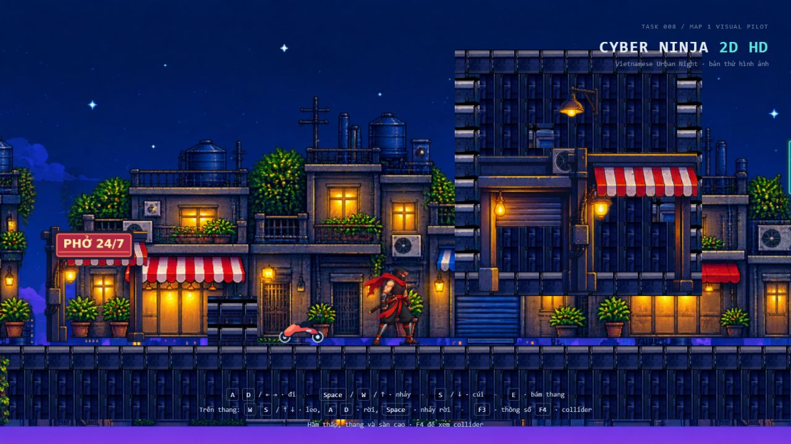
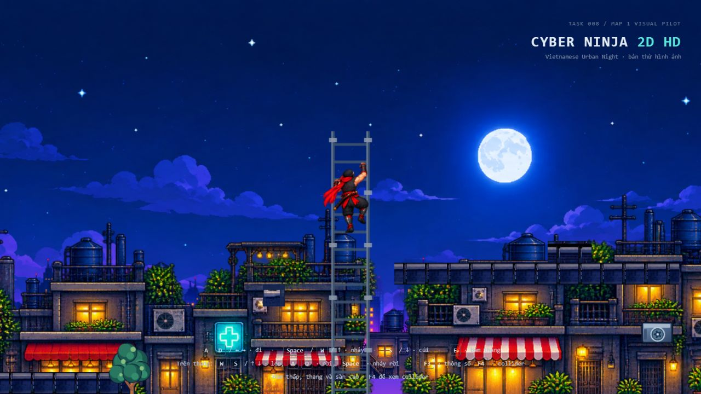
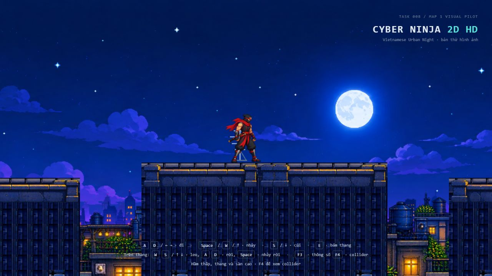
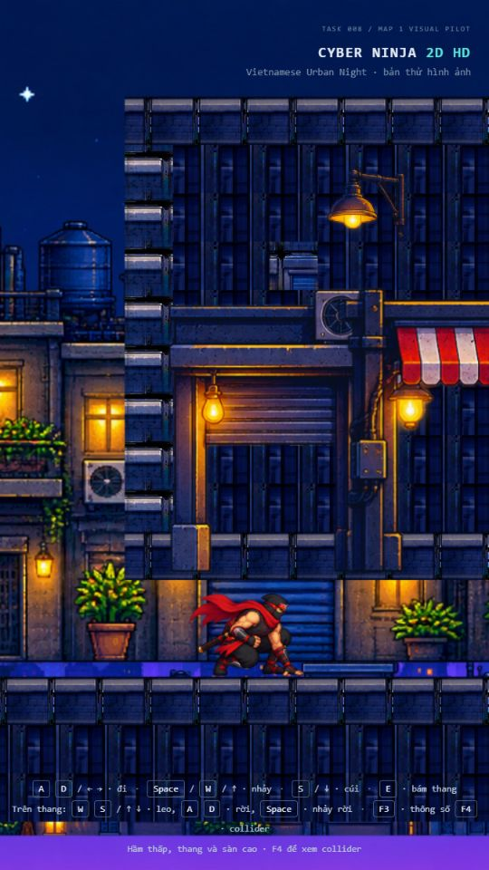

# Task 008 Fix — Visual Polish & Production Acceptance

## Kết quả và quyết định nghiệm thu

Đã sửa nền nhà theo chiều dọc, mặt tiền hầm, viền/mặt đứng mái, hình thang và lớp foreground. Giữ physics, animation và toàn bộ hình học gameplay Task 007. Không tạo Step 09 hoặc Task 009.

**Kỹ thuật và regression: đạt các kiểm tra đã thực hiện. Mỹ thuật production: chưa chốt; Step 09 chưa sẵn sàng để tự động bắt đầu.** Cần người dùng duyệt ảnh thật, đặc biệt mặt tường ghép từ atlas vẫn có nhịp lặp dọc và nối parapet còn mang tính modular. Chưa có artwork mặt tiền riêng theo kích thước các tòa nhà này; không tự thay bằng ảnh khác phong cách hoặc sửa collider để che hạn chế.

Baseline sạch `0a88337 Task008` trên master; tạo nhánh `task/008-visual-fix`. Áp dụng AGENTS.md người dùng cung cấp; không thấy file AGENTS.md khác trong cây Games đã tra cứu. Đã đọc Task 008, các module/parser/renderer/test, generator, graybox/pilot và metadata/ảnh atlas/near buildings trước khi sửa. Prompt Fix cho phép test/build và yêu cầu commit riêng. Không chạy lint/formatter, không thêm dependency.

## Source thay đổi

| File | Nội dung |
| --- | --- |
| `src/world/EnvironmentData.ts` | Neo dọc camera/world và layer foreground tùy chọn; báo lỗi field mâu thuẫn, Z/layer không hợp lệ |
| `src/rendering/EnvironmentRenderer.ts` | World Y ổn định cho layer được cấu hình; foreground renderOrder riêng, giữ alpha/disposal |
| `src/world/TilemapData.ts` | `sampleInset` tùy chọn theo layer, số nguyên không âm và nhỏ hơn nửa tile |
| `src/rendering/TilemapRenderer.ts` | UV sampling bên trong cùng tile, không sửa PNG, ID hoặc kích thước ô world |
| `src/world/LevelData.ts` | Màu `railHighlight` tùy chọn cho visual ladder |
| `src/world/TestLevel.ts` | Nét sáng ray và pát gắn khi có railHighlight; đường cũ không có field giữ nguyên |
| `scripts/generate_map01_pilot.mjs` | Mọi thay đổi bố cục/visual pilot; thêm chế độ `--check` không ghi file |
| `src/world/levels/map-01-visual-pilot.json` | Đầu ra generator, thay visual, không thay spawn/solid/climbable/bounds/deathY |
| `tests/EnvironmentData.test.ts`, `tests/EnvironmentRenderer.test.ts` | Giữ các trường hợp cũ, cập nhật expected artwork/ảnh/mesh theo pilot mới; bỏ so sánh visuals với graybox vì visual là phần được yêu cầu sửa |
| `tests/EnvironmentPolish.test.ts` (mới) | 25 trường hợp neo world/camera, resize/UV, foreground, tài nguyên, asset, generator và ladder |
| `docs/task-008-fix-*.jpg`, `docs/task-008-fix-runtime.json`, báo cáo này | Ảnh chạy thật production và mẫu runtime |

Đã xem diff từng module/source và git status. Trước thêm báo cáo: 10 tracked file, +574/-71 dòng, phần lớn là JSON sinh ra; file test/bằng chứng mới được Git liệt kê riêng. Có cảnh báo LF sẽ đổi CRLF khi Git chạm file; không chuẩn hóa formatting toàn file.

`git diff --exit-code 4f8b68f --` cho physics, entities, animation, input, config, GameLoop, FallRecovery, GameCamera, characters assets và bốn level gốc trả exit 0, không diff. Task Fix không sửa Game.ts, timestep, nội suy hoặc package/lockfile. Các test còn so chính xác 10 solid, climbable X=29, spawn, camera bounds/followY và deathY với graybox.

## Các sửa hình ảnh thực tế

### A — Hầm thành mặt tiền

Collider mái 5×5 tại (14.5,1), đáy Y=-1.5 và khoảng cúi 1 unit giữ nguyên. Thay phủ masonry ID12 tối đồng loạt bằng mặt tường ID3, hai pilaster ID4, mép trên/dưới ID11; cửa cuốn `shutter_shop`, cửa/mái hiên `street_shop_awning` và đèn `wall_light_amber` nằm trong khối mái. Hai chi tiết ID8 trong hầm vẫn đặt thưa. Cửa/mái hiên dùng tỷ lệ/worldSize metadata, không kéo dãn PNG. Player trước mặt tiền và đi được qua lối bên dưới, không bị decal phủ.

Atlas có các đường viền nổi trong từng ô; lặp toàn ô tạo nhiều sọc ngang. `sampleInset:20` chỉ ở lớp mặt tường lấy UV từ 20.5 đến 43.5 pixel bên trong ô 64px đang chọn, tránh lặp viền cap. Lớp mép mái/thùng/chi tiết vẫn dùng cả ô, inset mặc định 0 cộng nửa texel chống bleed như trước. Vẫn có họa tiết dọc; đây chưa phải mặt tiền bespoke hoàn chỉnh.

### B — Nhà và thang

Near buildings dùng `verticalAnchor:'world'`, `worldBottom:-2.7`, `worldHeight:8`, không cộng camera Y hoặc viewport height. Far/mid vẫn camera-relative, giữ parallax ngang 0.15/0.35; near giữ parallax ngang 0.65. “World” ở đây chỉ neo **chiều dọc** của panorama; props và mặt tiền hình học cố định cả X/Y. Sky vẫn cover một ảnh không lặp.

Dải tím ngang giữa chân nhà và nền khi camera leo lên đã hết trong các lượt quan sát. Các khe alpha giữa từng nhà vẫn thấy thành phố/màu tím phía xa; đó không phải phần nền bị tách khỏi chân nhà. Màn phố còn thấy một dải sky ở dưới đáy terrain hữu hạn khi viewport chạm Y=-4.5; không mở rộng collision hoặc tự che bằng asset sai phong cách.

Thang không có sprite thang riêng đã duyệt trong bộ foreground. Giữ hình học ray/bậc hiện có, đổi cyan sang thép `#3e536e`, opacity nền vùng leo 0, structureOpacity 0.9; thêm nét sáng `#8b98aa` và pát mỗi 1.2 unit. Bậc và chiều leo giữ nguyên; highlight/pát là visual Z=0.02/0.01 sau player Z=1. Không thay vùng leo, animation/pivot/physics. Thiếu texture thang riêng được ghi nhận, không dùng sprite lỗi làm thay thế.

### C — Mặt mái và mặt đứng

Tách lớp `roof-edges`, đặt 12 module `parapet_wall` theo worldSize metadata. Đỉnh hình đúng mặt sàn vật lý, toàn module nằm trong chiều rộng solid; không nhô sang các khe 48..50, 58..60, 68..70 và không tạo bậc giả phía trên mặt nhảy.

Sau ảnh thử phát hiện mái vẫn nổi, bổ sung mặt đứng **hậu cảnh không collision** từ đáy mái xuống Y=-2.5, giới hạn trong bề rộng từng mái, cùng các điểm cửa sổ thưa. Đây là tường phía sau người chơi, không phải sàn mới; không tô kín khe nhảy. Viền trên là mặt đi thật đã có. Nét ghép mặt đứng/parapet còn cần duyệt mỹ thuật; không tuyên bố đây là bộ kiến trúc production hoàn chỉnh.

## Schema và tương thích

- Background không có field mới giữ công thức Task 008. `verticalAnchor:'camera'` là lựa chọn tường minh tương đương mặc định. `verticalAnchor:'world'` chỉ dành cho layer repeat ngang, cần `worldBottom` hữu hạn; cấm parallaxY/bottomOffset khác 0 để tránh hai quy tắc neo đồng thời. Y tâm = worldBottom + worldHeight/2; UV ngang giữ công thức parallax cũ khi resize.
- Decoration mặc định sau player, -0.45 < Z < 0. `layer:'foreground'` cần 1 < Z < 9, renderOrder=1; các visual hiện có order=0, nên alpha foreground được vẽ sau player. Trong cùng nhóm, Three.js sắp theo Z và thứ tự tạo cố định từ dữ liệu. `collision:false` luôn bắt buộc; layer/Z không phát sinh collider.
- Hai foreground minh họa là `vine_strip_01`, tại (2.8,-4.15) và (39.5,-4.15), worldSize 0.5×1.5833, Z=2. Đỉnh dưới mặt đường, không che lối cúi, thang hoặc mép nhảy. Không đẩy tất cả asset có tên “foreground” ra trước player.
- `railHighlight` chỉ tạo nét sáng/pát khi khai báo, màu được kiểm như field color hiện có. Level cũ giữ visual và disposal cũ.
- Không thêm geometry/texture trong render frame. Cache texture, clone UV, shared geometry và cleanup của renderer cũ được giữ; test kiểm cả texture foreground.

## Asset và tái tạo

**Không tạo/thay PNG hoặc chỉnh metadata.** Tái sử dụng ảnh `APPROVED_VISUAL`/`APPROVED_MODULAR_ONLY`, không dùng quarantined. Asset mới được sử dụng so với Task 008: shutter_shop, wall_light_amber, vine_strip_01, parapet_wall; street_shop_awning đã được dùng trước đó. Tổng 19 URL environment duy nhất; 4 background và 29 decoration, hai dây leo chung ảnh. Tile dùng ID 2,3,4,8,10,11 trên atlas 1024²/64px; 64px vẫn 0.5 world unit. ID không dùng làm collision.

Lệnh tạo: `node scripts/generate_map01_pilot.mjs`. Lệnh đối chiếu không ghi: `node scripts/generate_map01_pilot.mjs --check`. Test gọi chế độ check, so chính xác byte JSON và đã qua sau thay đổi cuối. SHA-256 JSON đầu ra: `91458c86150091a38f5f8e7bcb4715c0c5070f3312cfce5a8e68c5e2d9dd11b9`. Không sửa riêng JSON để vượt generator.

## Test/build cuối

Node 24.22.1 có sẵn trên máy. `npm run test`: **354/354, 26/26 file, exit 0, 5.38 giây**. Toàn bộ 329 trường hợp trước vẫn còn, thêm 25 trường hợp; các expected thuộc visual pilot thay đổi được cập nhật theo yêu cầu, không xóa trường hợp physics/camera/animation cũ. Test mới gồm dữ liệu neo mâu thuẫn, Z/layer foreground sai, resize/pha UV, alpha/dispose, dimension/hash asset, parapet trong solid, legacy defaults, rail highlight và kiểm generator. Một lần test trung gian sai số ảnh dự kiến (19 trong khi khi đó thực tế 18) đã được sửa theo tập asset cuối; số trên là lượt cuối sau mặt đứng mái.

`npm run build`: **exit 0**, TypeScript qua, Vite 8.3.5, 36 module, **3.01 giây**. HTML 1.26 kB/gzip 0.69, CSS 1.52/0.70, JS **786.02/151.90 kB**, `index-CeY8G-AM.js`. Cảnh báo chunk >500 kB còn nguyên. Vitest gợi ý worker/isolation; không đổi cấu hình. Build trước đó có gợi ý thời gian plugin prepare-out-dir, lượt cuối không còn gợi ý này. Không chạy lint/formatter hay typecheck riêng ngoài script build được cho phép.

## Nghiệm thu thực tế

Dùng **IAB theo quyền thay Chrome/Edge người dùng đã cho trong chat**. Dev cổng 5174 quan sát trước sửa cuối, sau đó thao tác trên **production preview cổng 4174** sau build; không teleport/sửa state game. Ảnh dưới là screenshot thật của Three.js trên production, không mock/concept. Lượt cuối đi lại toàn tuyến sau bổ sung mặt đứng; ảnh A/B/dọc chụp trước thay đổi chỉ liên quan mặt đứng C, ảnh C đã chụp lại bản cuối.

| Thao tác | Kết quả quan sát |
| --- | --- |
| Chạy, nhảy thùng đầu, tới hầm | X=10.8 trước hầm, player đọc rõ |
| S+D vào hầm, nhả S, thử Space | X≈13.24/13.28, Y=-2.05, crouching, standingBlocked=true; không đứng xuyên mái |
| D qua hết hầm, nhảy bậc | Ra hầm đứng lại, chạm bậc X=20.6, nhảy qua tới 24.8 rồi chạy tới 28.8 |
| E+W lên thang, giữ tại đỉnh | X=29, Y=3.2, không vượt giới hạn |
| S/W/S đổi chiều, dừng | Y≈2.453 → 3.013 → 2.5, frame climbDown=2 giữ qua lần đọc sau; thang không trôi, sprite không lật |
| D rời thang, nhảy ban công lên mái | Đáp sàn ở (31.8,1.8), qua thùng và lên mái (39.4,2.8) |
| Qua các khe mái | 47.3 → 51.0 → 56.5 → 60.2 → 63.4 → 66.8 → 70.6 → 77.3; mép mái rõ, không foreground che |
| Camera dọc/trái/phải | (8,0) spawn; (29,3.2) trên thang; (63.4,4.3) mái; X=72 cuối màn 16:9 |
| Resize 1280×720, 1024×768, 540×960 | View thay theo tỷ lệ; player/hầm còn rõ, sky cover crop ở màn dọc; 4:3 biên phải camera X=74 |
| Rơi khỏi mép cuối | Respawns 0→1, về (2,-1.7), camera (8,0) tại 16:9 hoặc (6,0) tại 4:3; Space sau hồi sinh nhảy được |
| Graybox production | Mở `?level=map01-graybox`, gửi D+Space, có trạng thái nhảy/rơi; giữ hình cũ, console sạch |
| Legacy production | Mở playground/small/tiles, gửi D+Space, đọc state; không lỗi tải/console. Chỉ smoke check, chưa đi toàn tuyến từng level |
| Console | Map01 cuối tuyến và các level cũ: warn/error `[]` |

Đánh giá leo là quan sát khi thao tác, chưa đo từng frame hoặc trượt chân/tay bằng video; không chỉnh animation để che asset. Chưa giữ phím ở đáy thang trong task này. Chưa kiểm Chrome/Edge độc lập, DPR/thiết bị khác, context loss, gl.getError trực tiếp hoặc soak test.

Mẫu FPS trong `task-008-fix-runtime.json`: **53 mẫu F3**, 50 mẫu 60 FPS, một mẫu 56, hai mẫu 2 ngay khi khởi động/reload; min 2, trung vị/max 60. Có mẫu dev và hai lượt production, lấy không đều, gồm resize/chụp ảnh/warmup. Không gọi đây là benchmark GPU/1% low hoặc đảm bảo 60 FPS liên tục. Các lần smoke legacy sau đó không thuộc tập JSON này.

## So sánh ảnh trước/sau

Ảnh trước giữ nguyên từ Task 008 (1920×1061), sau A/B/C là 1280×720, màn dọc 540×960. Không cùng viewport/vị trí tuyệt đối, vì thế dùng đối chiếu bố cục/hình ảnh, không coi là pixel diff.

| Khu vực | Trước | Sau (production) |
| --- | --- | --- |
| A | [Task008 A](task-008-zone-a.jpg) | [Fix A](task-008-fix-zone-a.jpg) |
| B | [Task008 B](task-008-zone-b.jpg) | [Fix B](task-008-fix-zone-b.jpg) |
| C | [Task008 C](task-008-zone-c.jpg) | [Fix C](task-008-fix-zone-c.jpg) |
| Dọc | [Task008 dọc](task-008-narrow.jpg) | [Fix dọc](task-008-fix-narrow.jpg) |

## Giới hạn còn lại / Step 09

Mái có cạnh đi thật và mặt đứng nối xuống phố, nhưng vật liệu tường vẫn là ghép tile nền nên lặp dọc rõ, chưa có cửa sổ/tầng/chi tiết kiến trúc riêng ở các cao độ mái. Module parapet có đường nối/chồng đầu cần art review. Bộ asset chưa có mặt tiền bespoke cho tòa nhà hầm hoặc texture thang riêng; đã dùng thành phần chấp nhận được trong bộ duyệt, giữ nguyên PNG. Một số prop cũ có nét vẽ khác background, vẫn cần quyết định mỹ thuật của người dùng.

Chỉ nên chuyển Step 09 sau khi duyệt các ảnh A/B/C/dọc và chấp nhận hoặc cung cấp artwork thay thế cho những mặt đứng còn generic. Task này không tạo gói production và không tự coi art approval đã đạt. Commit Fix riêng trên nhánh nêu trên; không merge master hoặc push remote.
